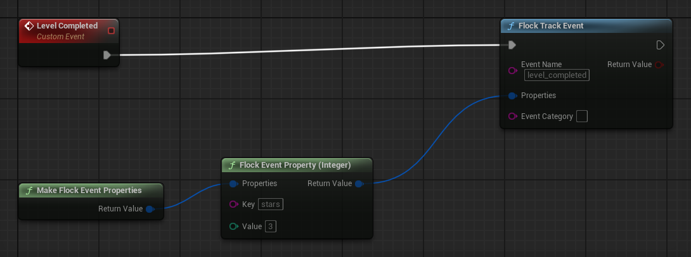

# Analytics

Sessions, screen views, gameplay events and transactions — what your players did. Everything below is off
when **Analytics Enabled** is unticked (**Project Settings → Plugins → Flock SDK Settings**, its **Analytics**
section).

The *Flock | Analytics* nodes carry two surfaces that are easy to confuse and must not be. This page covers
the first. The second — reports of what went wrong — is [Diagnostics](diagnostics.md), and it is read
somewhere else entirely.

| | Analytics | [Log events](diagnostics.md) |
|---|---|---|
| Answers | What did players do? | What went wrong? |
| Read by | Design, product, LiveOps | Engineering |
| Routes | `/v1/analytics/*` | `/v1/log_event` |
| Dashboard | **Dashboards → Game Metrics** | **Diagnostics → Events** / **Diagnostics → Errors** |
| Calls | `Flock Track Event`, the tracking plan's `Flock Track Level Start` and its siblings, `Flock Record Screen View`, sessions, purchase transactions | `Flock Log Diagnostic Event`, `Flock Log Diagnostic Error`, `Flock Log Diagnostic Exception`, automatic exception capture |
| Blueprint category | *Flock \| Analytics* | *Flock \| Diagnostics* |
| Custom data | **Event Properties** — a number stays a number | **Extra Data** — a map of strings |

A crash is not a funnel step. A level-complete written as a log entry is accepted, stored and shown under
Diagnostics, where nobody building a retention chart will look — and it never reaches Game Metrics. Pick
the call by the question you want answered, not by which node name is closest to hand.

## Blueprint

The nodes live under *Flock | Analytics* and **none of them needs the subsystem wired in** — they resolve
it from the calling graph: `Flock Track Event`, the tracking plan's events (`Flock Track Level Start` and the
rest, [below](#tracking-plan-events)), `Flock Record Screen View`, `Flock Set Analytics Consent`,
`Flock Flush Analytics`, plus the session nodes (`Flock Start Analytics Session`, `Flock End Analytics
Session`, `Flock Has Active Analytics Session`, `Flock Get Analytics Session Id`, `Flock Get Analytics
Snapshot`). All are safe no-ops before the SDK has initialized.



Build a gameplay event's **Properties** with the *Flock Event Property* nodes — *(Integer)*, *(Float)*,
*(String)*, *(Boolean)* and *(String Array)* — chained left to right, starting from *Make Flock Event
Properties* or straight off the Properties pin. Keys reach the dashboard exactly as you write them, and a
number stays a number, so it can be charted.

The same struct also backs the game-commands *Set Command …* nodes, and those still work here — the event
nodes are the analytics surface's name for it, so a graph recording a level completion never has to reach
for a node called *Set Command Int* to say what happened.

## C++

The calls live on the subsystem (`#include "FlockSubsystem.h"`; `"Flock"` in your module's `Build.cs`):

```cpp
UFlockSubsystem* Sdk = UFlockSubsystem::Get(this);

Sdk->TrackAnalyticsEvent(TEXT("level_complete"),
    FFlockCommandData().Set(TEXT("level"), 3).Set(TEXT("deaths"), 0).Set(TEXT("flawless"), true),
    TEXT("progression"));

Sdk->RecordAnalyticsScreenView(TEXT("MainMenu"));
```

## Gameplay events

`Flock Track Event` (`TrackAnalyticsEvent`) records one thing a player did: a name, an optional category,
and properties.

- **It never waits on the network.** The event is written to disk and delivered on the next flush, so it is
  safe to call often and while offline. It returns false only when it refuses the event outright, or drops it because nobody is signed in and
  **Analytics Cache Failed Events** is off, so there is no queue to hold it.
- **It is refused on the spot** when analytics is off, when consent is withheld, when the name is empty or
  blank, when the name is longer than 200 characters or the category longer than 100 (the server cannot store
  either, and would fail every event sent alongside), and for the name `session_started` — the server records
  that one itself when a session starts, and a copy from the game would count every session twice. The SDK's
  own events (below) are refused too, letter for letter, with a warning: `session_end`, `app_open`,
  `first_launch`, `app_update`, `store_purchase` and `screen_view`. `App_Open` is a different name, and yours.
- **Every event carries the `flock_` parameters** (below). A property you set under one of those names keeps
  your value.
- **Every event belongs to a player.** An event recorded with nobody signed in is held, and credited to
  whoever signs in next. Events are delivered only while a player is signed in; one recorded earlier keeps
  the player it was recorded under.
- **The player's session is attached** when one is open, even if the server has not answered the session
  start yet: its id is filled in when the event is sent.
- **An event the server refuses is dropped**, and the flush that met the refusal reports it — the rest of
  the queue is still delivered. An event the server merely could not take yet (an outage, a rate limit)
  stays queued.

## Tracking plan events

Your game's tracking plan, on the Flock dashboard, suggests the events worth sending. The most common ones each have a
call that sends the plan's event name, category and property names, so you never type them and the plan counts them as
sent:

| Event | Category | Properties | Blueprint | C++ |
|---|---|---|---|---|
| `level_start` | `gameplay` | `level`, `difficulty` | **Flock Track Level Start** | `TrackLevelStart` |
| `level_complete` | `gameplay` | `level`, `score`, `duration_seconds`, `stars` | **Flock Track Level Complete** | `TrackLevelComplete` |
| `level_fail` | `gameplay` | `level`, `reason`, `duration_seconds` | **Flock Track Level Fail** | `TrackLevelFail` |
| `checkpoint_start` | `gameplay` | `level`, `checkpoint` | **Flock Track Checkpoint** | `TrackCheckpoint` |
| `tutorial_step` | `ui` | `step`, `step_name` | **Flock Track Tutorial Step** | `TrackTutorialStep` |
| `settings_change` | `ui` | `setting`, `value` | **Flock Track Settings Change** | `TrackSettingsChange` |
| `match_start` | `gameplay` | `mode`, `map`, `team_size` | **Flock Track Match Start** | `TrackMatchStart` |
| `match_complete` | `gameplay` | `mode`, `result`, `score`, `duration_seconds`, `kills` | **Flock Track Match Complete** | `TrackMatchComplete` |

```cpp
#include "FlockSubsystem.h"

UFlockSubsystem* Sdk = UFlockSubsystem::Get(this);

Sdk->TrackLevelComplete(3, 1200, 95, 2); // level, score, duration_seconds, stars
Sdk->TrackLevelComplete(4, {}, {}, 0);   // only level and stars: zero stars is sent

// mode, result, no score, no duration, kills, and a property of the game's own
Sdk->TrackMatchComplete(TEXT("ranked"), FlockMatchResult::Win, {}, {}, 7,
    FFlockCommandData().Set(TEXT("weapon"), TEXT("bow")));
```

- **Every argument is optional, and one you leave out is not sent**, not even as a null or a zero. In C++ a number
  is a `TOptional<int32>`: pass `{}` to leave it out. An empty text is not sent either. Zero is a value: `stars`
  of 0 is sent.
- **In Blueprint, a number pin left at its default, -2147483648 (the lowest integer), is not sent.** Wire or type
  any other value, zero and negative numbers included, and it is sent. Leave a text pin empty to send nothing.
- **Extra Properties** (`ExtraProperties` in C++, an advanced pin on each node) adds more properties, built with the
  *Flock Event Property* nodes. An argument you set wins over the same key there, and your properties are not
  changed. A key matches whatever its letter case (`Kills` and `kills` are one key here), because an event's properties
  cannot hold two spellings of one key: if yours holds `Kills` and you pass `kills`, the call's `kills` is sent, `Kills`
  is not, and a warning names it.
- **The match result** takes **Flock Match Result Win**, **Loss** or **Draw** (`FlockMatchResult::Win`, `Loss`,
  `Draw` in C++: `win`, `loss`, `draw`), or a word of your own: the server takes any.
- **Each call is a `Flock Track Event` underneath**: the same consent, refusals, queue and `flock_` parameters, and
  it returns false when the event was refused or dropped. **Analytics Send Default Events** does not turn these off: they are
  your game's events, not the SDK's.

Any other event in your plan goes through **Flock Track Event** with the plan's name and properties.

## The SDK's own events and parameters

With **Analytics Send Default Events** on (the default, in the **Analytics** section), the SDK records these
itself. They are queued and delivered like your own events, behind **Analytics Enabled** and consent, and each
belongs to a player in the same way.

| Event | Category | When | Properties |
|---|---|---|---|
| `app_open` | `app` | Each start of the SDK, or when the player gives consent later in that run | — |
| `first_launch` | `app` | Once for this game on this device | — |
| `app_update` | `app` | A start on another **Project Version** than this game last started with on this device | `previous_app_version` |
| `session_end` | `session` | Each session's end | `reason`, `duration_seconds`, `screens_viewed`, `is_bounce`, `session_number`, `is_first_session`, `pause_count`, and `average_fps` / `min_fps` when frames were sampled |
| `screen_view` | `screen` | Each `Flock Record Screen View`, with or without a session | `screen_name` |
| `store_purchase` | `store` | The store's own dialog cancelled, failed or deferred a purchase ([Real-money purchases](real-money-purchases.md)) | `outcome` (`cancelled`, `failed`, `deferred`), `store`, `item_id`, `product_id` |

A `session_end`'s `reason` is `quit`, `timeout`, `sign_out`, `player_changed` (another player signed in without
signing out first), `restarted`, `ended_by_the_game`, or `unexpected_exit` (the game stopped with the session
open, a crash say, and the next launch found it). Each session gets one, credited to the player whose session it
was. `app_open` and `first_launch` recorded with nobody signed in are credited to whoever signs in next; with
**Analytics Cache Failed Events** off they, and a `session_end` with nobody signed in, wait in memory for that sign-in.
A purchase that was paid, sign-ins, achievements unlocked, multiplayer sessions and the player's country are recorded
by the server itself, so the SDK sends none of them.

**Every analytics event**, yours and the SDK's, carries these parameters among its properties:

| Parameter | Value |
|---|---|
| `flock_platform` | The engine's platform name (`Windows`, `Android`, …) |
| `flock_os` | The operating system and its version |
| `flock_device_model` | The device's make and model, when the engine knows it |
| `flock_app_version` | **Project Version** (**Project Settings → Project → Description**) |
| `flock_sdk_version` | This plugin's version |
| `flock_language` | The device's language (`en-US`, …) |
| `flock_session_number` | The session's number on this device, while a session runs |

A `session_end` found at the next launch carries the versions of the build its session ran on.

Unticking **Analytics Send Default Events** stops every event in the first table; your own events still carry
the parameters, and sessions are still recorded.

## Sessions

**Sessions** open when a player signs in and close on logout or quit, tracking duration, screen views,
pauses, and FPS. Backgrounding pauses the session; returning after **Analytics Session Timeout** starts a
fresh one. Starting a session while one is open replaces it, closing the old one first. Bind
`OnSessionStarted` / `OnSessionRegistered` / `OnSessionEnded` / `OnSessionPaused` / `OnSessionResumed` on
`GetEvents()`, or read `GetAnalyticsSnapshot()` for live metrics. `OnSessionRegistered` carries the id the server
gave the session, which `GetAnalyticsSessionId()` also returns once it has arrived.

With **Analytics Auto Start Session** on (the default) you never start or end one yourself. To do it by hand,
the analytics provider has `StartSession` and `EndSession`; `GetAnalyticsProvider()` is null when analytics is
off. In an actor whose header declares `UFUNCTION() void HandleSessionEnded(const FFlockSessionEndedArgs& Args);`:

```cpp
void AMyActor::BeginPlay()
{
    Super::BeginPlay();
    if (UFlockSubsystem* Sdk = UFlockSubsystem::Get(this))
    {
        Sdk->GetEvents()->OnSessionEnded.AddDynamic(this, &AMyActor::HandleSessionEnded);
    }
}

void AMyActor::ShowSession()
{
    UFlockSubsystem* Sdk = UFlockSubsystem::Get(this);
    if (Sdk->HasActiveAnalyticsSession())
    {
        const FFlockSessionSnapshot Session = Sdk->GetAnalyticsSnapshot();
        UE_LOG(LogTemp, Log, TEXT("%.0f s, %d screens, server id %s"),
            Session.DurationSeconds, Session.ScreensViewed, *Sdk->GetAnalyticsSessionId());
    }

    // Only when Analytics Auto Start Session is off, or to end one yourself. Null when analytics is off.
    if (FFlockAnalyticsProvider* Analytics = Sdk->GetAnalyticsProvider())
    {
        Analytics->StartSession();                                  // for the signed-in player
        Analytics->EndSession(EFlockSessionEndReason::Manual);
    }
}
```

`OnSessionEnded`'s `Args` carry the final snapshot and the reason (`Logout`, `Timeout`, `Quit`, `Restarted`,
`Manual`). `GetEvents()` returns a `UFlockEvents`, from `#include "FlockEvents.h"`.

`Flock Record Screen View` counts a view in the running session and records a `screen_view`. A name that is empty
or only spaces is neither counted nor recorded, and a warning says so.

A session reports the engine's platform name (Windows, Android and so on). Set **Session Platform** when the store
matters more than the operating system, for example `steam` for a Steam build. A value that starts or ends with a
space is not used: the engine's platform name is sent instead, and a warning says so.

**A session end is never lost.** Every close is written to disk before it is sent, so quitting, signing
out, losing the network, or crashing outright all cost delivery time rather than the record — whatever did
not go out drains on the next flush or the next launch. Queued ends wait for a signed-in player rather than
retrying against a closed door, so a game sitting on its title screen makes no analytics traffic at all. A
run that dies with a session open is picked up on the following launch and closed at the last moment it was
known to be alive, so a crashed session does not sit open on the backend forever. A session that could not
be registered when it started (offline at sign-in, say) registers itself when its end is finally delivered.

## Transactions

Purchases through the shop record their own transactions with no call from you. To record one yourself
(a sale through a store of your own, a refund), call `RecordTransaction` on the analytics provider. It is
**C++ only: there is no Blueprint node for it.** Transactions are sent at once rather than queued, need a
signed-in player (without one the call fails with an Auth error), and refuse a negative amount. The ids below
(`starter_pack`, `my_store`, `order-1234`) are examples: use your item's id and your own store's names.

```cpp
UFlockSubsystem* Sdk = UFlockSubsystem::Get(this);
if (FFlockAnalyticsProvider* Analytics = Sdk->GetAnalyticsProvider())   // null when analytics is off
{
    FFlockAnalyticsTransactionRequest Transaction;
    Transaction.Amount = 4.99;
    Transaction.CurrencyCode = TEXT("USD");
    Transaction.ShopItemId = TEXT("starter_pack");
    Transaction.TransactionType = TEXT("refund");
    Transaction.PaymentProvider = TEXT("my_store");
    Transaction.ExternalTransactionId = TEXT("order-1234");
    // PlayerId, SessionId and CreatedAt are filled in for you.

    Analytics->RecordTransaction(Transaction, [](TFlockResult<FFlockAnalyticsAck> Result)
    {
        if (!Result.bSuccess)
        {
            UE_LOG(LogTemp, Warning, TEXT("%s"), *Result.Error.ToDisplayText());
        }
    });
}
```

`TransactionType` defaults to `purchase`, `Status` to `completed` and `Quantity` to 1.

## Delivery and the offline queue

Gameplay events, log entries and session ends each have their own queue under the project's Saved
directory, capped by **Analytics Max Cached Events** (oldest dropped first). They are sent in batches on an
interval, when the app is backgrounded, or when you call Flush. Each game's queues are kept apart (by its API
URL and API key), so a project that switches to another game never sends the old game's queued entries to the
new one; what an earlier version kept for every game is sent by the first game to start after the update.

To send now — before a level change, or from a "send my data" button — flush. In Blueprint it is
`Flock Flush Analytics`; in C++:

```cpp
UFlockSubsystem* Sdk = UFlockSubsystem::Get(this);
if (FFlockAnalyticsProvider* Analytics = Sdk->GetAnalyticsProvider())   // null when analytics is off
{
    Analytics->Flush([](TFlockResult<FFlockAnalyticsAck> Result)
    {
        // Success means nothing was lost, not that the queue is empty.
        if (!Result.bSuccess)
        {
            UE_LOG(LogTemp, Warning, TEXT("%s"), *Result.Error.ToDisplayText());
        }
    });
}
```

A flush with nothing queued, one already running, or nobody signed in succeeds without sending anything.

- **A send that never reached the server keeps everything queued**, however long the game is offline.
- **A send the server answered without accepting counts against the entries it carried.** A gameplay event
  or log entry is dropped after 50 of those. After each one the interval flush waits twice as long, up to 15
  minutes, so a server outage uses up hours of retries rather than minutes.
- **An entry the server refuses outright is dropped.** When the server refuses a whole batch because of
  what is in it, the entries are sent one at a time, so only the entry it refused is lost.

## Consent

**Consent** is a gate, not a filter. With consent withheld there is no session and nothing is collected,
not even on disk. The decision persists between runs; withdrawing it discards the session outright — it is
not reported, not queued, and no `OnSessionEnded` is raised — along with anything already queued. Granting
it opens the session that sign-in could not — so in an opt-in flow, a player who agrees after signing in
still gets a session.

```cpp
UFlockSubsystem* Sdk = UFlockSubsystem::Get(this);

Sdk->SetAnalyticsConsent(true);            // persists; raises OnConsentChanged
const bool bOptedIn = Sdk->HasAnalyticsConsent();
Sdk->EraseLocalAnalyticsData();            // drops the queues, the decision, and any crash marker
```

Leave **Analytics Require Explicit Consent** off to collect by default (a withdrawal still applies), or tick
it for an opt-in flow where nothing is collected until you call `SetAnalyticsConsent(true)`.

> Analytics timestamps come from the device clock, so they are wrong if the player's clock is wrong.
> Session durations are unaffected — they are measured from frame deltas, not clock readings.

---

[← Back to the README](../README.md)
