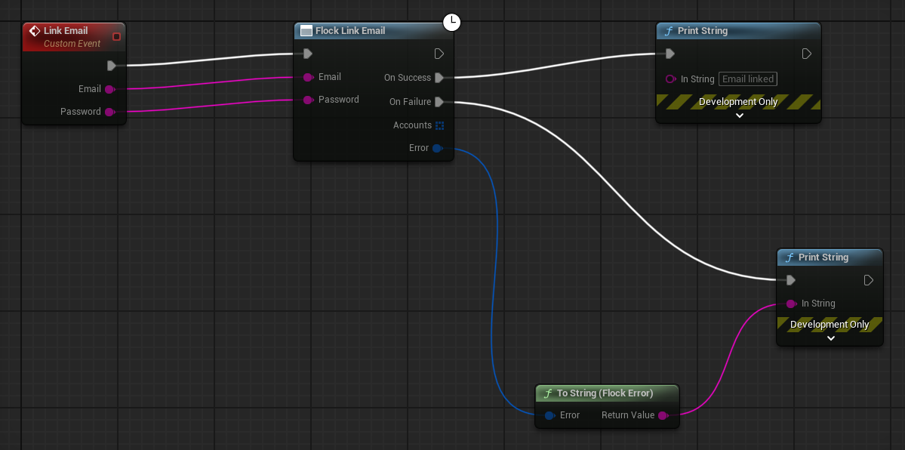

# Authentication

Sign players in with email, device id, Google, Apple, Steam, Facebook, or Discord. Tokens are stored
encrypted between launches and the session is restored automatically on startup; expired access tokens
refresh silently, including a one-shot retry for an authenticated call that raced the expiry. Only a 401 is
refreshed: a 403 means the player is not allowed to do that, and a new token would not change it.

## Providers at a glance

The SDK does not obtain the third-party credential for you — it takes the token your platform SDK
produced and exchanges it for a Flock session. What each provider expects:

| Provider | Credential | Where it comes from | Register? |
|---|---|---|---|
| **Email** | email + password | your own UI | ✅ |
| **Device** | a device id string | left empty: the GUID the SDK makes once and keeps (see [Device ids](#device-ids)) | ✅ |
| **Google** | an **ID token** | Google Sign-In on the platform | ✅ |
| **Apple** | an **identity token** | Sign in with Apple | ✅ |
| **Steam** | a **session ticket** | Steamworks `GetAuthSessionTicket` | ✅ |
| **Facebook** | a Facebook user id | Facebook SDK | ❌ login only |
| **Discord** | a Discord user id | Discord OAuth | ❌ login only |

**Facebook and Discord have no register call.** The backend exposes no dedicated route for them, so the
SDK posts to the generic login endpoint with the provider id. An account must already exist — there is no
`RegisterWithFacebook`, and adding one would only produce a call the server rejects.

For every other provider, **register and login are separate calls**, and what each does is:

| Call | Identity is new | Identity already has an account |
|---|---|---|
| Register | Creates the player **and signs them in** (`On Authenticated` fires) | A success with `bAlreadyRegistered` set (Blueprint: the Result's **Already Registered**); nobody is signed in |
| Login | Fails with `player.invalid_login_credentials` | Signs the player in |

So the first-launch flow is: register; if the result says the identity was already registered, log in.

### Device ids

Leave the device id empty, and the device calls use the SDK's own: `ThisDeviceId()` on the auth provider (Blueprint:
**Flock Get This Device Id**), a GUID the SDK makes the first time it is needed and keeps in `Saved/Flock/device_id.txt`,
beside the saved sign-in. So the same player comes back on every launch, and `Logout()` keeps it. An empty id means this
one for `LoginWithDevice`, `RegisterWithDevice` and `LinkDevice` and their nodes (**Flock Login With Device**, **Flock
Register With Device**, **Flock Link Device**, with *Device Id* left unwired); any other id is sent exactly as you pass it,
spaces included. (`FPlatformMisc::GetDeviceId` cannot be the id: it is empty on Windows, Mac and Linux.)

```cpp
// This install's device id: what the device calls send when their id is empty.
const FString DeviceId = UFlockSubsystem::Get(this)->GetAuthProvider()->ThisDeviceId();
```

A new one is made when the file is gone: a reinstall on a phone, a deleted or cleaned `Saved` folder. With a new id the
player signs in as somebody new, with none of their progress; to keep the player across a reinstall or a new device,
[link](#account-linking) an email or a social login to them. When the file can be neither read nor written, the SDK logs a
warning saying why and how to fix it, and uses an id for that run only.

Pass an id of your own only in two cases:

- **Your game already signs players in with an id of its own** (a GUID kept in a save game or a file, as earlier versions
  of this page showed): keep passing that same id. Leaving it empty would sign every existing player in to a new, empty
  account.
- **Two copies of the game started from one project folder** (Play In Editor beside a standalone game, two game clients
  on one machine) share `Saved/`, so they share the kept id and are one player. Pass another id in one of them.

## Blueprint

Every call is an async node under *Flock | Auth*, with no Target pin. Each has `On Success` and `On Failure` execution
pins, except **Flock Restore Session** (*On Restored* and *On No Session*) and **Flock Is Name Available** (*On Result* and
*On Failure*).

**Login:** `Flock Login With Email`, `… With Device`, `… With Google`, `… With Apple`, `… With Steam`,
`… With Facebook`, `… With Discord`.

**Register:** `Flock Register With Email`, `… With Device`, `… With Google`, `… With Apple`,
`… With Steam`.

Signing in with a device, the first launch and every later one:

1. **Check first whether a player is signed in already:** a Branch on **Flock Is Authenticated**. A saved sign-in is
   restored while the game starts, before any Event BeginPlay, so a returning player often is. On **True** there is
   nothing to do. Sign in only on **False**: a second sign-in ends the session the first one started, and a playtest
   waiting for that session never starts.
2. Run **Flock Register With Device** with *Device Id* empty: the SDK uses this install's own (see [Device ids](#device-ids)).
3. From its **On Success**, break the Result and branch on **Already Registered**:
   - **False**: a new device, registered **and signed in** by that one node. You are done.
   - **True**: the device already had an account and nobody is signed in yet. Run **Flock Login With Device**
     with the same device id, empty again.

   Never run On Success straight into the login: that would sign the player in twice, with the same result as above.
4. Run **On Failure** of either node into what you show errors with, putting `Error` through
   **To String (Flock Error)**.


**Session and account:** `Flock Restore Session`, `Flock Refresh Token`, `Flock Revoke Token`,
`Flock Forgot Password`, `Flock Reset Password`, `Flock Send Email Verification`, `Flock Verify Email`,
`Flock Is Name Available`.

Sign-in state needs no Target pin either — `Flock Is Authenticated`, `Flock Get Player Id`,
`Flock Is Restoring Session`, `Flock Get This Device Id` and `Flock Logout` resolve the SDK from the calling graph.

To react from anywhere rather than at the call site, bind `On Authenticated`, `On Logged Out`,
`On Session Restored`, and `On Auth Expired` on the [event hub](events.md).

## C++

Everything lives on the auth provider (`#include "FlockSubsystem.h"`; your module's `Build.cs` lists
`"Flock"`).

### Register, then log in, with a device

```cpp
UFlockSubsystem* Sdk = UFlockSubsystem::Get(this);
if (!Sdk || !Sdk->IsInitialized())
{
    return;
}
// Sign in once. A saved sign-in is restored while the game starts, so a returning player often is signed in already;
// a second sign-in would end the session the first one started.
if (Sdk->IsAuthenticated())
{
    UE_LOG(LogTemp, Log, TEXT("Already signed in as %s"), *Sdk->GetPlayerId());
    return;
}
const TWeakObjectPtr<UFlockSubsystem> WeakSdk(Sdk);

// An empty device id: this install's own (ThisDeviceId). No display name either.
Sdk->GetAuthProvider()->RegisterWithDevice(FString(), FString(),
    [WeakSdk](TFlockResult<FFlockRegisterResult> Registered)
    {
        UFlockSubsystem* Flock = WeakSdk.Get();
        if (!Flock || !Flock->IsInitialized())
        {
            return;
        }
        if (!Registered.bSuccess)
        {
            UE_LOG(LogTemp, Warning, TEXT("%s"), *Registered.Error.ToDisplayText());
            return;
        }
        if (!Registered.Value.bAlreadyRegistered)
        {
            // A new player: registering signed them in.
            UE_LOG(LogTemp, Log, TEXT("Registered and signed in as %s"), *Flock->GetPlayerId());
            return;
        }
        // This device has an account already: log in to it.
        Flock->GetAuthProvider()->LoginWithDevice(FString(),
            [](TFlockResult<FFlockPlayerLoginResponse> Login)
            {
                if (Login.bSuccess)
                {
                    UE_LOG(LogTemp, Log, TEXT("Signed in as %s"), *Login.Value.PlayerId);
                }
                else
                {
                    UE_LOG(LogTemp, Warning, TEXT("%s"), *Login.Error.ToDisplayText());
                }
            });
    });
```

The callbacks hold the subsystem weakly, never `this` or a raw pointer: an answer can arrive after the
level or the SDK is gone.

### Every provider

Only the credential argument differs between providers. `Email`, `Password` and the tokens come from your
sign-in screen and the platform's SDK; `OwnDeviceId` is an id of your game's own, for the two cases that pass one
(see [Device ids](#device-ids)). Each call below is a sign-in: make one of them, once, and only while `IsAuthenticated()`
is false, as above.

```cpp
auto OnLogin = [](TFlockResult<FFlockPlayerLoginResponse> Result)
{
    if (Result.bSuccess)
    {
        UE_LOG(LogTemp, Log, TEXT("Signed in as %s"), *Result.Value.PlayerId);
    }
    else
    {
        UE_LOG(LogTemp, Warning, TEXT("%s"), *Result.Error.ToDisplayText());
    }
};

FFlockAuthProvider* Auth = UFlockSubsystem::Get(this)->GetAuthProvider();

Auth->LoginWithEmail(Email, Password, OnLogin);
Auth->LoginWithDevice(FString(), OnLogin);          // empty: this install's device id
Auth->LoginWithDevice(OwnDeviceId, OnLogin);        // an id of your game's own, sent as it is
Auth->LoginWithGoogle(GoogleIdToken, OnLogin);
Auth->LoginWithApple(AppleIdentityToken, OnLogin);
Auth->LoginWithSteam(SteamSessionTicket, OnLogin);
Auth->LoginWithFacebook(FacebookUserId, OnLogin);   // login only
Auth->LoginWithDiscord(DiscordUserId, OnLogin);     // login only
```

Registration takes the same credential plus an optional display name — pass an empty string to omit it:

```cpp
FFlockAuthProvider* Auth = UFlockSubsystem::Get(this)->GetAuthProvider();

auto OnRegister = [](TFlockResult<FFlockRegisterResult> Result)
{
    if (Result.bSuccess && Result.Value.bAlreadyRegistered)
    {
        // Not a failure: this identity already has an account, and nobody was signed in. Log in instead.
    }
    else if (Result.bSuccess)
    {
        // A new account, and the player is signed in to it.
    }
};

Auth->RegisterWithEmail(Email, Password, TEXT("Nightjar"), OnRegister);
Auth->RegisterWithDevice(FString(), FString(), OnRegister);   // this install's device id, no display name
Auth->RegisterWithGoogle(GoogleIdToken, Name, OnRegister);
Auth->RegisterWithApple(AppleIdentityToken, Name, OnRegister);
Auth->RegisterWithSteam(SteamSessionTicket, Name, OnRegister);
```

## Account flows

`Email`, `Code` (from the email the player received) and `NewPassword` come from your screens:

```cpp
FFlockAuthProvider* Auth = UFlockSubsystem::Get(this)->GetAuthProvider();

auto OnDone = [](TFlockResult<FFlockAuthActionResponse> Result)
{
    if (!Result.bSuccess)
    {
        UE_LOG(LogTemp, Warning, TEXT("%s"), *Result.Error.ToDisplayText());
    }
};

Auth->IsNameAvailable(TEXT("Nightjar"), [](TFlockResult<FFlockNameAvailableResponse> Result)
{
    const bool bFree = Result.bSuccess && Result.Value.Available;   // advisory: register can still lose the name
});

Auth->ForgotPassword(Email, OnDone);                       // emails a reset code
Auth->ResetPassword(Email, Code, NewPassword, OnDone);     // works signed out

Auth->SendEmailVerification(OnDone);                       // to the signed-in player's address
Auth->VerifyEmail(Code, OnDone);

Auth->RefreshToken([](bool bRefreshed) { /* false: no refresh token, or the server refused it */ });
Auth->RevokeToken([](TFlockResult<FFlockTokenRevokeResponse> Result) { /* refresh token dead server-side */ });
Auth->Logout();                                            // local sign-out
```

## Account linking

A player can hold more than one credential. This is what turns a guest who started on a device into
someone who can sign back in on a new phone — they add an email or a social login, and the progress
stays on the same player.

```cpp
FFlockAuthProvider* Auth = UFlockSubsystem::Get(this)->GetAuthProvider();

// Every call answers with the player's full credential list.
auto OnAccounts = [](TFlockResult<FFlockPlayerAccountsResponse> Result)
{
    if (!Result.bSuccess)
    {
        if (Result.Error.ErrorCode == EFlockErrorCode::PlayerAccountAlreadyLinked)
        {
            // That credential belongs to another player.
        }
        return;
    }
    for (const FFlockPlayerLinkedAccount& Account : Result.Value.Accounts)
    {
        UE_LOG(LogTemp, Log, TEXT("%s %s"), *Account.Provider, *Account.Email);
    }
};

Auth->GetLinkedAccounts(OnAccounts);                       // what is attached right now

Auth->LinkEmail(Email, Password, OnAccounts);
Auth->LinkDevice(FString(), OnAccounts);                   // this install's device id
Auth->LinkGoogle(IdToken, OnAccounts);                     // also Apple / Steam / Facebook / Discord

Auth->Unlink(EFlockCredentialProvider::DeviceId, OnAccounts);
```

Every one of these answers with the player's **full updated credential list**, so a link or an unlink
doubles as a refresh — you never need a separate re-read afterwards. Each listed account carries a
typed `ProviderType` you can hand straight back to `Unlink`, plus the provider's user id, the email
where there is one, and whether that email is verified.

Blueprint gets the same nine as nodes under **Flock|Auth** (`Flock Get Linked Accounts`, `Flock Link
Email`, `Flock Unlink Account`, …). `OnAccountLinked` and `OnAccountUnlinked` fire on the events hub
with the provider that changed.



Four coded errors are worth handling in-game:

| Code | Means |
| --- | --- |
| `PlayerAccountAlreadyLinked` | That credential belongs to another player. There is no account-merge flow — this reaches your code and you decide what to tell the player. |
| `PlayerAccountNotLinked` | Nothing to unlink for that provider. |
| `PlayerCannotUnlinkLastCredential` | The server refuses to leave a player with no way back in. |
| `PlayerInvalidLinkRequest` | The request itself was rejected. |

## Session lifecycle

`TryRestoreSession` runs automatically after initialization, during the game's startup:

- **The saved access token is still valid:** the player is signed in at once, before any `BeginPlay`.
  `On Authenticated` and `On Session Restored` have already fired by the time your actors bind them.
- **The saved access token has expired:** the SDK refreshes it first, which takes a network round trip.
  `Is Restoring Session` is true until it answers, then `On Session Restored` fires.
- **Nothing was saved:** `On Session Restored` fires with false, again during startup.

`OnSessionRestored` is raised on **every** outcome, failure included, so it is the event for "decide which
screen to show" — but only while a restore is still running. Check first:

```cpp
// MyActor.h, in the UCLASS:
//     UFUNCTION() void HandleSessionRestored(bool bRestored);
//     UFUNCTION() void HandleAuthExpired();

void AMyActor::BeginPlay()
{
    Super::BeginPlay();

    UFlockSubsystem* Sdk = UFlockSubsystem::Get(this);
    if (!Sdk)
    {
        return;
    }
    UFlockEvents* Events = Sdk->GetEvents();
    Events->OnAuthExpired.AddDynamic(this, &AMyActor::HandleAuthExpired);

    if (Sdk->IsRestoringSession())
    {
        // The saved sign-in is being renewed over the network: wait for the answer.
        Events->OnSessionRestored.AddDynamic(this, &AMyActor::HandleSessionRestored);
    }
    else
    {
        // The restore finished during startup, or there was nothing to restore.
        HandleSessionRestored(Sdk->IsAuthenticated());
    }
}
```

`UFlockEvents` comes from `#include "FlockEvents.h"`. `On Auth Expired` means a refresh failed and the
player must sign in again: send them to your sign-in screen. In Blueprint, the same check is
`Flock Is Restoring Session` → Branch, then either bind `On Session Restored` or read
`Flock Is Authenticated`; `Flock Restore Session` runs a restore yourself, with **On Restored** and
**On No Session** pins.

## Things worth knowing

- **An already-registered identity is a success, not an error.** Registering an account that exists
  completes with `bAlreadyRegistered` set and nobody signed in, so you can route the player to a login
  rather than show a failure. It is logged as a warning, not an error, for the same reason.
- **Registering a new identity signs the player in.** `On Authenticated` fires, and the tokens are saved
  like a login's.
- **The display name is optional and server-enforced unique.** `IsNameAvailable` is a preflight, not a
  reservation — two players can both pass the check and one still lose at register time. Handle it.
- **`ForgotPassword` always reports success.** The backend never reveals whether an address has an
  account, so success means "if that address exists, a code was sent". Do not use it to test whether
  someone is registered.
- **Password reset works signed out.** `ResetPassword` sends the email, the code from `ForgotPassword`
  and the new password, and the route takes no token, so a player who forgot their password can reset it
  from the sign-in screen. The server refuses a wrong or expired code.
- **`RevokeToken` is the server-side kill**, and the thing to reach for when a token is stolen — it
  invalidates the refresh token for good. Call `Logout` afterwards for a full sign-out; `Logout` alone
  only clears local state.
- **Token storage is an AES-encrypted file** under the project's Saved directory, keyed to the machine,
  user, and game. It defeats casual copying and inspection, not code running as the same user. Implement
  `IFlockTokenStore` to plug in platform keychain storage instead.
- **Each game keeps its own saved sign-in**, named by its API URL and API key, so a project that switches to
  another game (or another backend) never restores a player of the old one. The sign-in an earlier version kept
  is taken over by the first game that reads one, so updating signs nobody out.
- **The email-verification routes need a bearer.** It rides along automatically when a player is signed
  in, and the server requires it — so those calls fail with a 401 when signed out.
- **A call made for a player stays that player's.** A call that acts as the signed-in player (the inbox, a
  rank, linking, a purchase and the like) sends its retries only while that sign-in lasts:
  - If the player signs out, or another player signs in, while it is waiting to retry, the retry is not
    sent and the call fails with `EFlockErrorType::Cancelled`.
  - A call that looks something up first (a purchase reads its item, scheduling by name looks up the
    template, cancelling every schedule reads the list) is not sent at all if the sign-in changed meanwhile.
  - A token refresh that comes back after the sign-in it was for has ended is dropped: it does not sign the
    new player out or replace their token.
  - A refresh that comes back after `ShutdownSdk` still has its new tokens saved for the next
    initialization, but only where the saved sign-in still holds the same player's token it replaced, since
    the server no longer takes that one. Flock initialized again meanwhile waits for that answer rather
    than sending the same refresh token again.
  - A sign-in answered after `ShutdownSdk` is not kept, and its caller hears `EFlockErrorType::Cancelled`.
  - When the server refuses a refresh because another run of the game, sharing the saved sign-in, renewed
    it first, the player carries on with that newer sign-in instead of being signed out.

---

[← Back to the README](../README.md)
