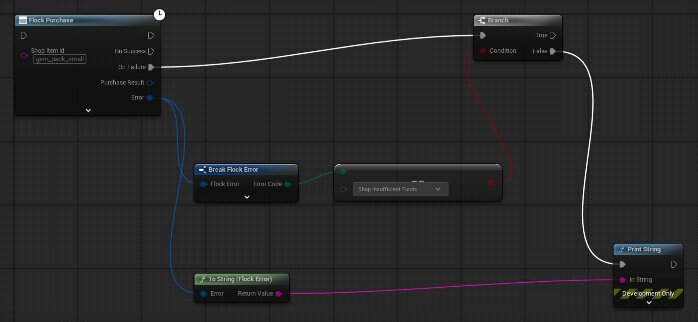

# Errors

Every SDK call answers with a `TFlockResult<T>` rather than throwing — Unreal builds with exceptions
off. On failure the result carries an `FFlockError`, and that error is written to be **read by a
developer at 2am**: it names the call that failed, the server's own reason, the machine-readable code,
and the next step to take.

## The one line you want

`To String (Flock Error)` in Blueprint, `FFlockError::ToDisplayText()` in C++, composes all four:

```
Device login failed: Invalid credentials [player.invalid_login_credentials, HTTP 401]
Fix: This device is not registered yet. Call Flock Register With Device once to create the account, then Flock Login With Device on later launches (with Device Id empty, both use the id the SDK keeps for this install).
```

Every failure says what is wrong and how to fix it. A segment is dropped only when there is nothing to
say: a failure that never reached the server has no status and no code, so it reads as its cause and
its fix alone:

```
The server did not answer in time
Fix: Check the device's network connection, then try again; the SDK retries a read by itself. A purchase or other change that timed out may still have been made, so read the result before sending it again.
```

The **raw response body is deliberately not in there**. It is unbounded payload, and it is what makes
an error-tracker group every failure into its own bucket. Read `Error.Body` when you want it, or
`Error.ToString()`, which is the same log-friendly text plus the body.

## What is on the error

| Field | What it holds |
|-------|---------------|
| `Type` | `EFlockErrorType` — Auth, Validation, Network, Connection, Timeout, Serialization, Cancelled, Store |
| `Message` | What is wrong, in one sentence: the server's own reason when it gave one, otherwise the SDK's (`The server found nothing at this address`). Never the fix and never the status |
| `ServerMessage` | The server's own wording of the failure, when the body carried one |
| `Code` / `ErrorCode` | The backend's `detail.code` string, raw and as a typed `EFlockErrorCode` |
| `Hint` | How to fix it — the `Fix:` line above. Never empty |
| `Operation` | Short label of the call that failed (`Device login`, `Purchase shop item`) |
| `StatusCode` | HTTP status when the failure came from a response; `0` for transport and client-side failures |
| `Body` | The raw response body |
| `bHasRetryAfter` / `RetryAfterSeconds` | The server's Retry-After hint, when it sent one |
| `StoreFailureReason` | On an error of type Store: why the store did not take the payment, one of `FlockStoreFailureReasons` (`Cancelled` when the player closed the store's dialog). Empty otherwise |
| `bOutcomeUnknown` | On a call that moves money or items (a purchase, a store redemption, a web checkout, a consume, a fund grant): no answer said whether it was done, so it may have been. Never offer it again on that answer alone: what to read first depends on how it was paid (see [After a money call whose outcome is unknown](#after-a-money-call-whose-outcome-is-unknown)), and `Hint` says it too. Always false on a call that moves nothing |

## Branch on the code, never on the text

`ErrorCode` is the typed view of the backend's coded-error contract. Message wording is the server's to
change; the code is a contract.

Here in an actor buying a shop item, where `ItemId` is the item's id (from the shop's items, see
[Shop](shop.md)) and `ShowTopUpScreen` is the actor's own function:

```cpp
FFlockShopProvider* Shop = UFlockSubsystem::Get(this)->GetShopProvider();
const TWeakObjectPtr<AMyActor> WeakThis(this);

Shop->Purchase(ItemId, [WeakThis](TFlockResult<FFlockPurchaseResult> Result)
{
    if (Result.bSuccess)
    {
        return;
    }
    if (Result.Error.ErrorCode == EFlockErrorCode::ShopInsufficientFunds)
    {
        if (AMyActor* Self = WeakThis.Get())
        {
            Self->ShowTopUpScreen();
        }
        return;
    }
    UE_LOG(LogTemp, Warning, TEXT("%s"), *Result.Error.ToDisplayText());
});
```

In Blueprint the same branch is `Error Code` off the broken-out struct (**Break Flock Error**), compared
against the `EFlockErrorCode` literal — no string typing involved:



`EFlockErrorCode::Unknown` means the body had no code, or one this SDK version predates. The raw string
is still on `Error.Code`, so a newer backend code is never lost, only untyped, and the fix names it.

### Groups, not single codes

`Is Already Registered` (`UFlockErrorLibrary::IsAlreadyRegistered`) groups the five identity codes
where a register call reports the identity already exists, because that is one caller concept with one
remedy. A taken **display name** is deliberately outside the group — different fix. There is no
predicate wrapping a single code; compare `ErrorCode` directly for those.

## Hints

`Hint` is filled from a table keyed on `EFlockErrorCode`, never on message text, and it is stamped the
moment the error is built — so any failure with a recognised code carries its remedy no matter which
layer produced it. When the code has no advice of its own, the fix is the one for the kind of failure:

| Failure | Fix |
|---------|-----|
| No answer in time | Check the network; a change that timed out may still have been made, so read before re-sending |
| No connection | Check the device is online and that API URL is the server's address alone |
| An answer with no Flock code | Something other than Flock's game API answered (a proxy, a captive portal, another server): check API URL |
| An unreadable success | The same: a captive portal or another server answered |
| A server failure (5xx) | Not caused by the call: try again later |
| A code newer than this SDK | The server's reason is all there is; the fix names the code |
| A failure the SDK finds itself | Its own fix (an empty argument names what to pass; nobody signed in says to sign in) |

Every failure Flock's game API sends carries a code. `request.not_found` with a bare `Not Found` is the server saying no
route answers at that address (with any other reason it names a record the route did not find): **API URL**
(**Project Settings → Plugins → Flock SDK Settings**) must be the server's address alone, such as
`https://api.example.com`, with no `/v1` or other path after it.

One code is genuinely ambiguous and gets refined by the credential that hit it:
`player.invalid_login_credentials` means *"this device has no account, register it"* for a device login
and *"wrong password"* for email. The HTTP layer cannot tell which, so the auth provider refines the
hint on the way out.

Hints name real calls only. Facebook and Discord have no registration route, so their hint points at
`Flock Link Facebook` / `Flock Link Discord` and never at a register node that does not exist.

## Validation failures name the field

The backend reports two different `detail` shapes, and both are parsed:

- The game routes send a coded object — `{"detail":{"code":"...","message":"..."}}` — which fills
  `Code` and `ServerMessage`. A request the server refuses before any route runs (a member missing from
  the body) comes coded `request.validation_failed`, its message naming the field
  (`body.shop_item_id: Field required`).
- An older server's request-validation layer sends an **array of field errors** instead, which carries no
  code at all. Those render into `ServerMessage` as the field path and the reason:

```
Update player data failed: body.player_data: Input should be a valid dictionary [HTTP 422]
```

At most three fields are spelled out; the rest collapse into a `(+2 more)` tail so one bad request
cannot flood a log line.

## Which failures are worth retrying yourself

Mostly none — the SDK already retries transient failures with backoff, honours `Retry-After`, and never
retries Auth, Validation, Serialization, Cancelled or Store. What is left for you:

| Failure | What happened | What to do |
|---|---|---|
| `EFlockErrorType::Connection` | No answer came: the request could not reach the server, or the connection dropped after it went out, so the server may have done it | A read backed by the offline cache serves its last good copy instead. A money call that may have gone out ends with `bOutcomeUnknown` set: follow [After a money call whose outcome is unknown](#after-a-money-call-whose-outcome-is-unknown), never offer it again on this answer. `AddGameFunds` refused before sending (no connection, `bOutcomeUnknown` false) may be offered again once the device is online. Any other change that is not queued: make it again once the device is online, if it still applies |
| `EFlockErrorType::Auth` after a refresh | The session is gone | Send the player back to sign-in, after checking `StatusCode` and `ErrorCode` (below) |
| `EFlockErrorType::Store` | The platform's store (Google Play, the App Store) did not take a real-money payment, or a web checkout's payment gateway declined it or let it expire; nothing was charged | `StoreFailureReason` says why and `Hint` what to do. Offer the item again if the player wants it: see [Real-money purchases](real-money-purchases.md) |
| `EFlockErrorType::Cancelled` | You cancelled the call, or it was made for a player who has since signed out or been replaced by another sign-in, so its retry was not sent | Nothing to retry: make the call again for the player now signed in, if it still applies. A cancelled call is never answered from the offline cache |
| A money call that failed (a purchase, a store redemption, a web checkout, a consume, a funds grant) | It may have been done anyway | Check `bOutcomeUnknown`: when it is set, follow [After a money call whose outcome is unknown](#after-a-money-call-whose-outcome-is-unknown) |
| A 5xx naming a setting someone has to fix | The game's payment keys the server cannot read (`PaymentProviderCredentialsUnreadable`), or a Flock server with no address for a payment provider to confirm a payment (`ShopRealCurrencySettlementUnavailable`) | Fix the setting: it is never retried, and it stays the same until the setting is fixed |

**An Auth failure is not always a lost session.** The SDK refreshes only a 401, so a 403 reaches you as it
came:

- A 403 carrying `MatchmakingNotPartyLeader`, `MatchmakingPlayerNotEligible`, `MultiplayerNotHost` or
  `PartyNotPartyLeader` means the player is not allowed to do that, and signing in again changes nothing.
- A 403 carrying `ShopPlayerMismatch` (a purchase naming another player than the one signed in) or
  `PaymentProviderReceiptBelongsToAnotherPlayer` (a store purchase that is another player's) leaves the
  player signed in; the fix says which player the call has to act for.

**A cancelled money call may have gone out.** A purchase, store redemption, consume or fund grant that was
cancelled may have been sent before the cancel, so its cached player data is dropped: read the wallet and
inventory before making the call again.

**Money calls are re-sent only where the server makes it safe:**

- A consume or a funds grant: an ambiguous failure is surfaced rather than re-sent, because a timed-out
  request may already have committed.
- A wallet purchase is the first exception: every attempt of one `Purchase` call carries the same key and
  the server makes one purchase of them, so the SDK re-sends it itself.
- Redeeming a store purchase (`RedeemStoreReceipt`) is the second: the server makes one purchase per store
  transaction, so the SDK re-sends it, and you send the same receipt again later when it still fails.
- Opening a web checkout is never sent again after an answer that did not come: a second one would be a second
  payment page.
- Whichever it is, your game makes the call again only on a deliberate player action, never automatically, and
  only after the reads below.

### After a money call whose outcome is unknown

`bOutcomeUnknown` set (the Blueprint **Outcome Unknown** pin) means no answer said whether it was done. What to do
depends on how the item was paid for:

- **A wallet purchase, a consume, `AddGameFunds`:** the server may have done it. Read the wallet and the inventory
  from the server before acting: the SDK dropped its cached copy of the player's data, so the next read asks the
  server. A new `Purchase` call is a new purchase under a new key, and can charge twice. `AddGameFunds` may be offered
  again only when it was refused before sending (no connection, `bOutcomeUnknown` false).
- **A phone store (Google Play, the App Store):** the store already took the payment, since Flock delivers only
  after the store has charged; only Flock's delivery is unknown. Tell the player it will arrive, then call
  `UFlockStore::Restore` or wait for `OnPurchaseCompleted`. **Never offer the item again** on this answer: the store
  keeps the purchase unfinished and hands it back, and Flock answers a repeat with what it delivered the first time.
- **A web checkout (Windows, Mac and Linux):** the payment page may still be paid. Read the player's open checkouts
  (`UFlockStore::Restore`, or `GetPurchases(FlockPurchaseStatuses::Pending, ...)`) before offering it again; a checkout
  paid meanwhile is delivered by Flock, so read the wallet and inventory too.

See [Real-money purchases](real-money-purchases.md#how-the-call-ends) for every way a store purchase ends.

## Where failures show up in the log

Every failing call is logged as a warning by the HTTP layer with the server's error document (first 512
characters), and the provider logs the operation that failed with the same text `ToDisplayText()` gives,
its `Fix:` line included. Neither needs debug logs turned on — see
[Logging & debugging](logging.md).
