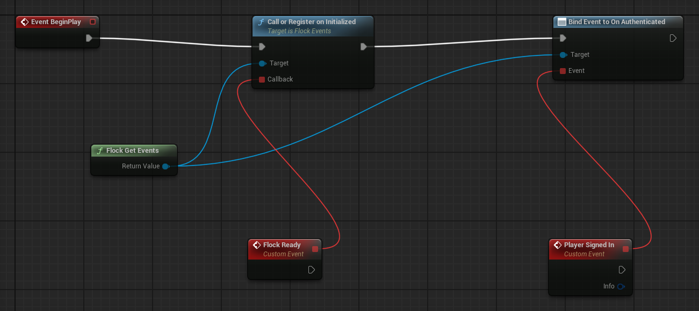

# SDK events

`GetEvents()` returns the SDK event hub (`UFlockEvents`): lifecycle (`OnInitialized`,
`OnInitializationFailed`, `OnShutdown`), auth (`OnAuthenticated`, `OnTokenRefreshed`, `OnAuthExpired`,
`OnLoggedOut`, `OnSessionRestored`, `OnAccountLinked`, `OnAccountUnlinked`), session
(`OnSessionStarted`, `OnSessionRegistered`, `OnSessionEnded`, `OnSessionPaused`, `OnSessionResumed`), notifications
(`OnUnreadCountChanged`, `OnNotificationReceived`), consent (`OnConsentChanged`), and real-money purchases
(`OnStorePurchaseCompleted`, `OnStorePurchaseNotDelivered`, raised with the connected store's own events). All are
Blueprint-assignable and raised on the game thread.

## When to bind

Binding in `BeginPlay` (or Event Construct in a widget) is right for every event that happens **later**:
a sign-in, a session ending, a purchase. It is too late for what already happened while the game started,
because the SDK initializes, and restores a saved sign-in, before any `BeginPlay` runs:

| What you want to know | Do this |
|---|---|
| The SDK finished initializing | `CallOrRegister_OnInitialized` (**Call or Register on Initialized**): runs at once if it already happened, otherwise on the next initialization. Not a plain `OnInitialized` binding, which misses it |
| Initialization failed | `CallOrRegister_OnInitializationFailed`, the same way |
| A player is signed in | Read `Is Authenticated`; if `Is Restoring Session` is true, bind `OnSessionRestored` for the answer (see [Authentication](authentication.md#session-lifecycle)) |
| Anything from now on (a sign-in, a purchase, a session end) | Bind the event in `BeginPlay` |

## Blueprint

`Flock Get Events` (self-resolving, no Target pin needed) returns the hub. Drag off it:

- **Call or Register on Initialized**, with a custom event on its Callback pin, for "the SDK is ready".
- **Bind Event to On Authenticated** (or any other event), with a custom event, for things that happen
  later.



## C++

`#include "FlockSubsystem.h"` for `UFlockSubsystem` and `#include "FlockEvents.h"` for `UFlockEvents`. Every handler is a `UFUNCTION()` of a `UObject`, because
the events are dynamic delegates. In an actor whose header declares `UFUNCTION() void HandleFlockReady();`
and `UFUNCTION() void HandlePlayerSignedIn(const FFlockAuthInfo& Info);`:

```cpp
#include "FlockEvents.h"
#include "FlockSubsystem.h"

void AMyActor::BeginPlay()
{
    Super::BeginPlay();

    if (UFlockSubsystem* Sdk = UFlockSubsystem::Get(this))
    {
        // Initialization already happened under auto-init: CallOrRegister runs this at once in that case.
        FFlockInitializedCallback OnReady;
        OnReady.BindDynamic(this, &AMyActor::HandleFlockReady);
        Sdk->GetEvents()->CallOrRegister_OnInitialized(OnReady);

        // An ordinary event: heard from now on, every time it is raised.
        Sdk->GetEvents()->OnAuthenticated.AddDynamic(this, &AMyActor::HandlePlayerSignedIn);
    }
}

void AMyActor::EndPlay(const EEndPlayReason::Type EndPlayReason)
{
    if (UFlockSubsystem* Sdk = UFlockSubsystem::Get(this))
    {
        Sdk->GetEvents()->OnAuthenticated.RemoveDynamic(this, &AMyActor::HandlePlayerSignedIn);
    }
    Super::EndPlay(EndPlayReason);
}
```

`FFlockAuthInfo` carries the `PlayerId` and the `Method` (`Email`, `Device`, …, or `SessionRestore`).
Removing the binding in `EndPlay` is tidy rather than required: a destroyed handler is skipped.

## Things worth knowing

- **Auto-init fires before you can bind.** Initialization completes during GameInstance startup, so a
  plain `OnInitialized` binding made in `BeginPlay` misses it. Use `CallOrRegister_OnInitialized` (or
  `CallOrRegister_OnInitializationFailed`) — it fires immediately when init already happened, otherwise
  on the next init. One-shot.
- **Subscriptions survive `ShutdownSdk()`.** They stay bound across re-initialization and are released
  with the GameInstance (dynamic delegates hold weak references, so destroyed subscribers are skipped).
- **A session has two ids.** `OnSessionStarted` carries the local id, the moment the session begins.
  `OnSessionRegistered` follows once the server has answered, with the local id and the server's id, which is
  the one every other record of the session is filed under. It fires once per session, never for a session
  that ended before the server answered, and it is not replayed: if you bind after a session registered, read
  `GetAnalyticsSessionId()` instead. With **Analytics Heartbeat Interval** at 0, a start call that failed is not
  retried while the session runs, so it does not fire for that session.
- **The notification events are fetch-derived, not pushed.** There is no realtime channel and the SDK
  never polls, so `OnNotificationReceived` means *first seen by a read* — it rides the inbox and summary
  calls your game already makes and adds no traffic of its own. The first read for a player is silent, so
  an existing inbox never arrives as a burst on launch. See [Notifications](notifications.md).

---

[← Back to the README](../README.md)
