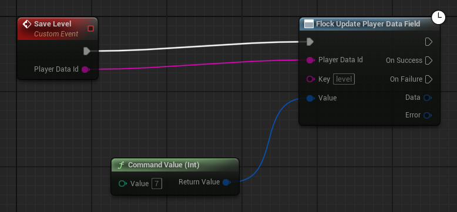

# Game commands

Commands are the only way to change a player's data: the server validates the write against the
template and answers with the whole updated row, which the SDK writes back into the player cache — so a
read straight after a write sees the new values.

Two calls write a row, and they are not interchangeable:

| Call | Sends | Use it to |
|---|---|---|
| Update Player Data Field (`UpdatePlayerDataField`) | One field | Change one value; every other field keeps its value |
| Update Player Data (`UpdatePlayerData`) | The whole row | Replace the row. The server needs **every field the template declares, nullable ones included**; a row missing one is refused with `game_command.template_validation_failed`, naming the field. Offline the call answers success at once with a provisional row, and that refusal arrives only when the write is replayed, which drops it (see [Things worth knowing](#things-worth-knowing)) |

Both need the row's id: the `Id` of the player's row, which a read hands you (`Flock Get My Data By Tag`,
`GetMyDataByTag`, and the other reads in [Player data](player-data.md)).

## Blueprint

The nodes live under *Flock | Commands*: `Flock Update Player Data`, `Flock Update Player Data Field`,
`Flock Unlock Achievement`, `Flock Add Game Funds`, and `Flock Flush Pending Commands`.

To change one field, give `Flock Update Player Data Field` the row's id (**Player Data Id**), the field's
name as the template declares it (**Key**), and a **Value** made by a *Command Value (…)* node (*Int*, *Float*, *String*, *Bool*,
*String Array*, *Json*):



To replace the whole row, build its values for `Flock Update Player Data` by dragging off the **Data** pin
and chaining *Set Command Int / Float / String / Bool / String Array*, one per field the template
declares. Each of those takes **and returns** an `FFlockCommandData`, so they chain left to right; leave
the first one's **Data** unwired, and it starts from an empty bag. There is also *Set Command Json* for a
nested shape.

`Flock Get Pending Command Count` drives a "syncing…" indicator while offline writes wait to replay.

If you have run a schema sync, the generated `Save <Template>` macro replaces this whole chain with one
node — see [Code generation](codegen.md).

## C++

Everything lives on the command provider (`#include "FlockSubsystem.h"`). One field, after reading the
row's id:

```cpp
UFlockSubsystem* Sdk = UFlockSubsystem::Get(this);
const TWeakObjectPtr<UFlockSubsystem> WeakSdk(Sdk);

// The signed-in player's row of the template tagged "progress" (use your template's tag).
Sdk->GetPlayerProvider()->GetMyDataByTag(TEXT("progress"), [WeakSdk, Level](TFlockResult<FFlockPlayerData> Row)
{
    UFlockSubsystem* Flock = WeakSdk.Get();
    if (!Row.bSuccess || !Flock || !Flock->IsInitialized())
    {
        return;
    }
    // Writes "level" alone; every other field of the row keeps its value.
    Flock->GetCommandProvider()->UpdatePlayerDataField(Row.Value.Id, TEXT("level"), Level,
        [](TFlockResult<FFlockPlayerData> Result)
        {
            if (!Result.bSuccess)
            {
                UE_LOG(LogTemp, Warning, TEXT("%s"), *Result.Error.ToDisplayText());
            }
        });
});
```

`Level` is the `int32` to save; a value converts to `FFlockCommandValue` from an int, a float, a bool, a
string or a string array.

The whole row, an achievement, and funds, where `RowId` is the row's `Id` as above:

```cpp
UFlockSubsystem* Sdk = UFlockSubsystem::Get(this);
auto OnSaved = [](TFlockResult<FFlockPlayerData> Result)
{
    if (!Result.bSuccess)
    {
        UE_LOG(LogTemp, Warning, TEXT("%s"), *Result.Error.ToDisplayText());
    }
};

// Replaces the whole row of a progress template: every field it declares, nullable ones included. Never a wallet:
// currency changes only through purchases, consumes and AddGameFunds.
Sdk->GetCommandProvider()->UpdatePlayerData(RowId,
    FFlockCommandData().Set(TEXT("level"), 7).Set(TEXT("checkpoint"), TEXT("forest_gate")).Set(TEXT("prestige"), true),
    OnSaved);

// The row of the template tagged "achievement" is found for you.
Sdk->GetCommandProvider()->UnlockAchievement(TEXT("first_win"), OnSaved);

// The wallet row is found from the template tagged "currency". Never queued, never sent twice.
Sdk->GetCommandProvider()->AddGameFunds(TEXT("coins"), 250, [](TFlockResult<FFlockPlayerData> Result)
{
    if (!Result.bSuccess && Result.Error.bOutcomeUnknown)
    {
        // No answer came: the coins may have been added. Read the wallet before granting again.
    }
});

// Writes made offline wait here; they replay on their own, or now:
const int32 Waiting = Sdk->GetPendingCommandCount();
Sdk->GetCommandProvider()->FlushPendingWrites([](TFlockResult<int32> Delivered) { /* Delivered.Value sent */ });
```

## Things worth knowing


- **Field names go out verbatim — use the template's names, not the ones you read back.** The SDK never
  case-transforms a write key, because only you know what the backend stores. Note that a *read* is not
  symmetric with a write here: a row's flattened data exposes `game_currencies` as `GameCurrencies` (so a
  struct can bind to it), and the dotted getters accept either spelling. A write has no such tolerance —
  the server matches the template exactly, so writing the name `Get Data Field Names` handed you is
  rejected with `game_command.template_validation_failed`. Write the name as the template declares it.
  (`FFlockPlayerTemplateSchema::SchemaJson` carries the declared names verbatim if you need to look them
  up at runtime; `Flock.SelfTest`'s commands sweep does exactly that.)
- **Values keep their type.** An int stays an int and a bool stays a bool on the wire — the builder is
  not a string map.
- **Data writes queue offline.** An update or achievement unlock made with no connectivity is saved to
  disk, applied optimistically to the cached row, and replayed in order when the connection returns —
  automatically on sign-in, on returning to the foreground, and on reconnect. The queue belongs to the
  player who made the writes and survives quitting the game.
- **A queued write answers success before the server has seen it.** Its callback gets a provisional row: the cached row
  with your change on it, or an empty row when the row was not cached. The server checks it only at replay, so a refusal
  such as `game_command.template_validation_failed` (a whole row missing a field) never reaches the callback: the write is
  dropped, its provisional value undone, and the refusal logged as an error. Send whole rows with every field the
  template declares, and read the row again after a replay when it matters.
- **Money does not.** Change a wallet only through purchases, consumes and `AddGameFunds`, never with a row write, which
  would be queued offline and replayed. `AddGameFunds` fails with a Connection error when the server is unreachable rather
  than queueing (`bOutcomeUnknown` false: nothing was sent, so it may be offered again once online), and is never re-sent
  after an ambiguous failure (a timeout may mean the credit already landed). No offline grants, no double credits. A grant
  that got no answer fails with `bOutcomeUnknown` set and drops the cached player data: read the wallet from the server
  before granting again.
- **A queued write is only discarded when the backend rejects it** — which is a question of *who* said no,
  not which number came back. A permanent 4xx from the server is an answer, so that write is dropped and
  its optimistic value rolled back rather than blocking everything behind it. Everything else keeps the
  whole queue for the next attempt: a temporary failure, an expired session (401 clears when you sign back
  in), a response the SDK cannot parse — a captive-portal login page answering a write with an HTML `200`
  means the server never saw it, and throwing the change away on that would lose work the player did — and
  a **403 with no error code in it**, which is a proxy or network gateway rather than the backend refusing
  the write.
- **A write that never becomes deliverable is dropped after 50 replay attempts.** This is a backstop, not a
  retry budget: a real outage should keep the player's writes, and a flush only happens on sign-in, on
  returning to the foreground, and on reconnect, so 50 of them span a long time. It exists so that no
  failure the SDK cannot classify is able to hold the queue — and every write behind it — indefinitely. The
  count is persisted with the entry, so it spans relaunches the way the queue itself does.

---

[← Back to the README](../README.md)
