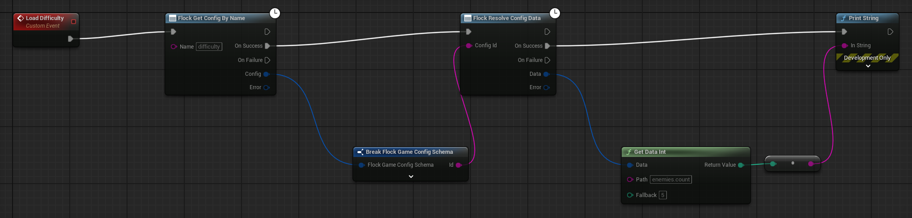

# Game config & metadata

A **game config** is a named bag of tuning values you edit on the dashboard and read at runtime — damage
numbers, feature switches, drop tables. A **patch** overrides a config's values for one game version, so
you can change 1.2 without touching 1.1.

Configs are game-wide and read-only from a client. Changing one is a dashboard action, which is why there
is no write call here — see [Game commands](game-commands.md) for the per-player data you *can* change.

## Resolve, don't fetch

Nearly every graph wants **the effective values for this game version**, not the raw config and not the
patch. That is one call:

`ResolveConfigData` returns the patch's data when a patch applies to the running game version, and the
config's own data when none does; with a player signed in, a gameplay or feature config's values are the ones the server
resolves for that player (see [Values for the signed-in player](#values-for-the-signed-in-player)). The caller never learns
which happened, which is the point — the resolution policy stays out of your gameplay code.

It takes the config's **id**. The id is on the config's record: read the record by its dashboard name
(`Flock Get Config By Name`, `GetConfigByName`) and pass its `Id` on, as below. After a schema sync, the
generated function library also holds each config's id as a constant (see [Code generation](codegen.md)).

Reach for the individual config and patch reads only when you specifically need to know what is
overriding what.

### Values for the signed-in player

What `ResolveConfigData` (and the generated `Get <Config>` nodes, which call it) gives depends on whether a player is
signed in:

- **Nobody signed in**: the game-wide values, the newest patch of this build's Game Version for the config, or the
  config's own values when no patch changes it.
- **A player signed in**: for a **gameplay** or **feature** config, the values the server resolves for that player: the
  newest patch, then the overrides of the segments the player is in, then the player's own overrides. Overrides apply to
  those two kinds only, so any other config (currencies, achievements, assets) reads as it does with nobody signed in.
  Once the server has answered, the SDK holds the player's values for that sign-in, so a later read makes no call; a new
  sign-in (another player, or the same one again) or `ClearCache()` reads them afresh. The player's values are also kept on
  disk per player: offline, a read gives that player's last values, else the game-wide ones, never another player's.
- **When the player's read cannot answer**, the game-wide values answer. A refusal (the server knows no such player, has no
  Game Version to read, or no config of that name) holds for the rest of the sign-in; no answer (no connection, a 5xx)
  gives the player's saved values, else the game-wide ones, and the player's read is sent again on a read 30 seconds or
  more later. The SDK logs one warning a sign-in when the server got no Game Version with the request, with the fix.

So a game that reads a config before the player signs in (at startup, on a title screen) should read it again once they
have, or it keeps showing the game-wide values: bind **On Authenticated** on the [event hub](events.md) and resolve the
config again there.

## Blueprint

The nodes live under *Flock | Config* and *Flock | Game*:

| Node | Returns |
|---|---|
| `Flock Resolve Config Data` | the effective values — **start here** |
| `Flock Get Config By Name` | one config, found by its dashboard name |
| `Flock Get Config By Id` | one config |
| `Flock Get Configs By Tag` | every config carrying a tag |
| `Flock Get Player Features` | the feature-flag config resolved for one player |
| `Flock Get Game` | the game record |
| `Flock Get Game Version` | the running version's record |
| `Flock Get Game Version By Name` | another version, by name |

`Flock Get Configs By Tag` takes one of the config tags: **Any** (no filter), **Gameplay**, **Currency**,
**Asset**, **Feature** or **Achievement**, sent as `gameplay`, `currency`, `asset`, `feature` and
`achievement`.

The **Data** pin is an `FFlockStructuredData` handle. Read it with the *Get Data …* nodes, each taking a
dotted path (`stats.damage`):

| Node | Fallback |
|---|---|
| *Get Data Int*, *Get Data Float*, *Get Data String*, *Get Data Bool* | A **Fallback** pin, returned when the field is absent, so a missing value never breaks a graph |
| *Get Data String Array* | None: an absent field gives an empty array |
| *Has Data Field* | Says whether the field is there at all |

Load a value in one chain — get the config by its name, resolve its id, read a field:



After a schema sync this collapses to one node: `Get Gameplay` fetches, resolves, and hands back a typed
struct with real pins. See [Code generation](codegen.md).

**Not in Blueprint yet:** patch reads (all patches, by id, by config) and configs-by-version-tag are C++
only. `Flock Resolve Config Data` already returns patched-or-base values, which is what those reads are
usually wanted for.

## C++

Configs and patches live on the config provider; the game record lives on the game provider
(`#include "FlockSubsystem.h"`):

```cpp
UFlockSubsystem* Sdk = UFlockSubsystem::Get(this);
const TWeakObjectPtr<UFlockSubsystem> WeakSdk(Sdk);

// The config's id comes from its record: here found by its dashboard name.
Sdk->GetConfigProvider()->GetConfigByName(TEXT("gameplay"), [WeakSdk](TFlockResult<FFlockGameConfigSchema> Config)
{
    UFlockSubsystem* Flock = WeakSdk.Get();
    if (!Config.bSuccess || !Flock || !Flock->IsInitialized())
    {
        return;
    }
    // The effective values for this game version: the patch's when one applies, else the config's; a gameplay or
    // feature config's as the server resolves them for the signed-in player, when one is.
    Flock->GetConfigProvider()->ResolveConfigData(Config.Value.Id, [](TFlockResult<FFlockStructuredData> Data)
    {
        if (!Data.bSuccess)
        {
            return;
        }

        int32 Damage = 10;   // kept when the field is missing
        Data.Value.TryGetInt(TEXT("weapons.sword.damage"), Damage);

        // Or bind the whole thing to a USTRUCT of your own:
        FMyGameplayTuning Tuning;
        Data.Value.GetDataAs<FMyGameplayTuning>(Tuning);
    });
});
```

`FMyGameplayTuning` is a `USTRUCT()` you declare in your own header, with a `UPROPERTY()` per field you
want, named like the config's fields (`max_health` binds to `MaxHealth`). `GetDataAs` returns false when
there is no data. Each `TryGet…` (`TryGetString`, `TryGetInt`, `TryGetFloat`, `TryGetBool`,
`TryGetStringArray`) leaves its out-value alone and returns false when the field is missing.

The game's records and feature flags:

```cpp
UFlockSubsystem* Sdk = UFlockSubsystem::Get(this);

Sdk->GetGameProvider()->GetGame([](TFlockResult<FFlockGameSchema> Game) { /* Game.Value.Name */ });
Sdk->GetGameProvider()->GetGameVersion([](TFlockResult<FFlockGameVersionSchema> Version) { /* Version.Value.Name */ });

// Feature flags for one player (an empty id is the signed-in player).
Sdk->GetConfigProvider()->GetPlayerFeatures(FString(), [](TFlockResult<FFlockGameConfigSchema> Features)
{
    bool bNewShop = false;
    if (Features.bSuccess)
    {
        Features.Value.Data.TryGetBool(TEXT("new_shop"), bNewShop);
    }
});

// Every config tagged "feature".
Sdk->GetConfigProvider()->GetConfigsByTag(EFlockConfigTag::Feature,
    [](TFlockResult<TArray<FFlockGameConfigSchema>> Configs) { /* Configs.Value */ });
```

The C++-only reads are on the same provider: `GetAllPatches`, `GetPatchById`, `GetPatchesByConfig` and
`GetConfigsByVersionTag`.

## Things worth knowing

- **Reads are cached and snapshot-backed.** A config fetched once is memoized, written to the offline
  snapshot, and served without a network call next launch. Concurrent fetches of the same key are
  coalesced into one request. A signed-in player's resolved values are held for that sign-in and kept on
  disk per player.
- **Player features are kept in memory per player for the run, never on disk.** The first `Get Player Features` for
  a player fetches; later ones for the same player answer from memory until `ClearCache()` or the next launch, which
  always asks the server again.
- **Dotted paths match exactly first, then the Pascal-cased name.** A field declared `max_health` reads
  back as `MaxHealth` in the flattened data, and both spellings resolve — so a path copied from the
  dashboard works, and so does one copied from a Break node.
- **Dictionary keys are never transformed.** Object and list field names are Pascal-cased on read so a
  struct can bind to them; a dict's keys are author data and stay verbatim.
- **The schema is kept verbatim** on every config, which is what codegen reads to emit typed structs.
- **`ClearCache()`** drops the in-process caches and the config snapshot category, the player's values
  included. C++ only.

---

[← Back to the README](../README.md)
