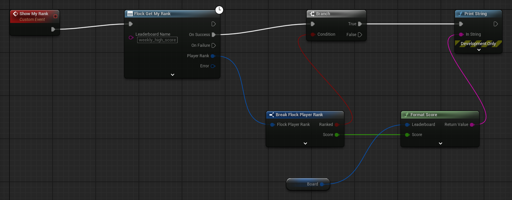

# Leaderboards

A **leaderboard** ranks players by one of their player-data fields. The board declares which template and
field it projects over, how repeated writes fold together, and which direction wins.

**There is no submit call, and none is needed.** Because a board is a projection, a player moves up it by
writing the field it ranks — with a game command, exactly as any other data write. If you are looking for
`SubmitScore`, it is [`UpdatePlayerDataField`](game-commands.md).

Boards are addressed by **name** — the name you gave the board on the dashboard. The name is what goes on
the wire, so a read is a single request and no read ever takes an id.

## Blueprint

The nodes live under *Flock | Leaderboard*:

| Node | Inputs | Returns |
|---|---|---|
| `Flock Get Leaderboard` | Leaderboard Name | the board's configuration |
| `Flock Get Leaderboard Standings` | Leaderboard Name, `Page` (1), `Limit` (50) | a page of ranked entries |
| `Flock Get My Rank` | Leaderboard Name | the signed-in player's placement |
| `Flock Get Standings Around Me` | Leaderboard Name, `Neighbours` (5) | the `Neighbours` entries either side of them |

Each fires **On Success** or **On Failure** (with the error). The last three also take a **Window** and a **Country** in
their advanced section (the little arrow).

Reading a board and its standings works signed out. **My Rank** and **Standings Around Me** need a
signed-in player and fail immediately when there is none.

The helpers, which have no execution pins, are on the same menu:

| Node | Does |
|---|---|
| `Make Current Window` | the board's live window — all-time, this week, or this season |
| `Make Season Window` | one finished season, from its id |
| `Make Period Window` | a raw period key, such as `2026-W31` |
| `Is Current Window` | true for the live window |
| `Format Score` | renders a score the way the board measures it |
| `Is Higher Better` | true when a bigger number wins |
| `Flock Refusal Reason Score Bounds`, `Flock Refusal Reason Gain Limit` | why a board turned a score away (see [Submitting a score](#submitting-a-score)) |

Leave the **Window** pin unconnected for the board's live window, which is what most screens want.

### Showing a player's rank

`Flock Get My Rank` returns a **Player Rank** with a **Ranked** boolean. A player who has not scored yet
is a *successful* read with `Ranked` false — not an error. Branch on `Ranked` before showing `Rank` or
`Score`; `Format Score` already returns an empty string for an unranked player (its **Ranked** pin, in the advanced
section, takes the player rank's Ranked), so a text binding needs no branch of its own.



`Format Score` needs the board's configuration (from `Flock Get Leaderboard`), so read the board once when the screen opens
and keep it.

### Formatting scores

Do not print `Score` directly. A board can measure an integer, a float, or a **duration in seconds**, and
`Format Score` is what turns `83.25` into `1:23.250` on a time-trial board. Feed it the board from
`Flock Get Leaderboard` and the score from a standings row or a player rank.

## C++

Everything lives on the leaderboard provider. `Sdk` is the Flock subsystem, `UFlockSubsystem::Get(this)` from any actor,
widget or the game instance. A completion runs later, so it holds the subsystem weakly and asks for the provider again:

```cpp
#include "FlockSubsystem.h"
#include "Providers/FlockLeaderboardProvider.h"

const TWeakObjectPtr<UFlockSubsystem> WeakSdk = Sdk;

// The board's configuration — needed for FormatScore and IsHigherBetter.
Sdk->GetLeaderboardProvider()->GetByName(TEXT("HighScoreTest"),
    [WeakSdk](TFlockResult<FFlockLeaderboard> Board)
    {
        if (!Board.bSuccess || !WeakSdk.IsValid())
        {
            return;
        }

        // Top of the board's live window.
        WeakSdk->GetLeaderboardProvider()->GetStandings(TEXT("HighScoreTest"),
            [Board](TFlockResult<FFlockStandings> Standings)
            {
                if (!Standings.bSuccess)
                {
                    return;
                }
                // Total is the board's full entry count, not Items.Num() — page from it.
                for (const FFlockStandingEntry& Entry : Standings.Value.Items)
                {
                    const FString Text = Board.Value.FormatScore(Entry.Score);
                    UE_LOG(LogTemp, Log, TEXT("#%d %s %s"), Entry.Rank, *Entry.PlayerName, *Text);
                }
            });
    });
```

The signed-in player's own placement, and the players around them:

```cpp
// Board: the FFlockLeaderboard read with GetByName above, kept by the screen.
Sdk->GetLeaderboardProvider()->GetMyRank(TEXT("HighScoreTest"),
    [Board](TFlockResult<FFlockPlayerRank> Rank)
    {
        if (!Rank.bSuccess)
        {
            UE_LOG(LogTemp, Warning, TEXT("%s"), *Rank.Error.ToDisplayText());
            return;
        }
        if (!Rank.Value.Ranked)
        {
            // A valid answer: this player has no entry on the board yet.
            return;
        }
        UE_LOG(LogTemp, Log, TEXT("You are #%d with %s"), Rank.Value.Rank, *Board.FormatScore(Rank.Value.Score));
    });

Sdk->GetLeaderboardProvider()->GetAroundMe(TEXT("HighScoreTest"),
    [](TFlockResult<FFlockStandings> Around) { /* five either side by default */ });
```

These reads, and `GetStandings`, take an explicit window and country on their longer overloads:

```cpp
Sdk->GetLeaderboardProvider()->GetStandings(TEXT("HighScoreTest"), FFlockLeaderboardWindow::Season(TEXT("s7")),
    TEXT("SA"), /*Page*/ 1, /*Limit*/ 25, [](TFlockResult<FFlockStandings> Result) {});
```

`ResolveId` exists for logging and deep links. Nothing in the read API consumes the id it returns — every
read addresses the board by name, and the name is what goes on the wire.

## Submitting a score

Write the field the board ranks:

```cpp
// PlayerTemplateId: the id of the player template the board ranks (its source template, in the dashboard).
const TWeakObjectPtr<UFlockSubsystem> WeakSdk = Sdk;
Sdk->GetPlayerProvider()->GetMyDataByTemplate(PlayerTemplateId,
    [WeakSdk](TFlockResult<FFlockPlayerData> Row)
    {
        // An empty Id means the player has no row for that template yet: there is nothing to update.
        if (!Row.bSuccess || Row.Value.Id.IsEmpty() || !WeakSdk.IsValid())
        {
            return;
        }
        // The field the board projects over, named as the template declares it.
        WeakSdk->GetCommandProvider()->UpdatePlayerDataField(Row.Value.Id, TEXT("Score"), FFlockCommandValue(9001),
            [](TFlockResult<FFlockPlayerData> Written)
            {
                if (!Written.bSuccess)
                {
                    UE_LOG(LogTemp, Warning, TEXT("%s"), *Written.Error.ToDisplayText());
                    return;
                }
                for (const FFlockLeaderboardRefusal& Refusal : Written.Value.LeaderboardRefusals)
                {
                    UE_LOG(LogTemp, Display, TEXT("%s turned the score away: %s"), *Refusal.LeaderboardName, *Refusal.Reason);
                }
            });
    });
```

The write itself succeeds, but a board can still turn the new score away: `Written.Value.LeaderboardRefusals` lists
those boards, each with its `LeaderboardName`, a `Reason` (`score_bounds`, outside what the board accepts, or
`gain_limit`, the player's recent gains fill its allowance; compare with the *Flock Refusal Reason* nodes or
`FlockLeaderboardRefusalReasons`), whether it is `Retryable`, and `RetryAfterSeconds` (-1 when the server gave none).
Only Update Player Data and Update Player Data Field report them, so an empty list after a read, Add Game Funds or
Unlock Achievement means "not reported here", not "no board refused". The cached row never keeps them.

The write key is the field name the **template declares**, not the Pascal-cased name a read gives back —
see [Game commands](game-commands.md). Whether the new score appears on the board immediately or on a
delay is the backend's business; re-read the rank to find out, and call `ClearCache()` first if you need
to be certain the read is not served from the snapshot.

## Board configuration

`FFlockLeaderboard` carries what a UI needs to render the board correctly:

| Member | Means |
|---|---|
| `ValueType` | `Integer`, `Float`, or `DurationSeconds` (scores are in seconds) |
| `Direction` | `Higher` or `Lower` — use `IsHigherBetter()` |
| `Aggregation` | `Best`, `Latest`, or `Sum` — how repeated writes fold |
| `WindowType` | `Never`, `Weekly`, or `Seasonal` — how the board buckets over time |
| `Scope` | `Global` or `Country` |

`WindowType` describes how the board buckets; it is **not** what you pass when reading. Reading takes an
`FFlockLeaderboardWindow`, and leaving it at `Current()` asks for whichever window the board is serving
now.

The field a board ranks is deliberately not exposed — the server does not send it to clients.

## Caching

Board configurations, standings, and player placements are cached to disk under the game version and
served when the network is down, so a leaderboard screen shows the last-known board rather than an error.
An authoritative failure — a board that no longer exists — still surfaces.

Placements are cached **per player**, so one player's rank is never shown to the next player on a shared
device, and the whole leaderboard cache is dropped on sign-out. `ClearCache()` drops it on demand.

A board name your game does not have fails rather than returning an empty board, because an empty
leaderboard and a typo look identical in a UI.
