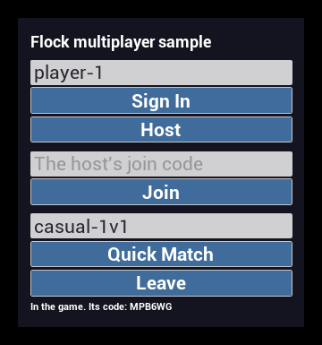
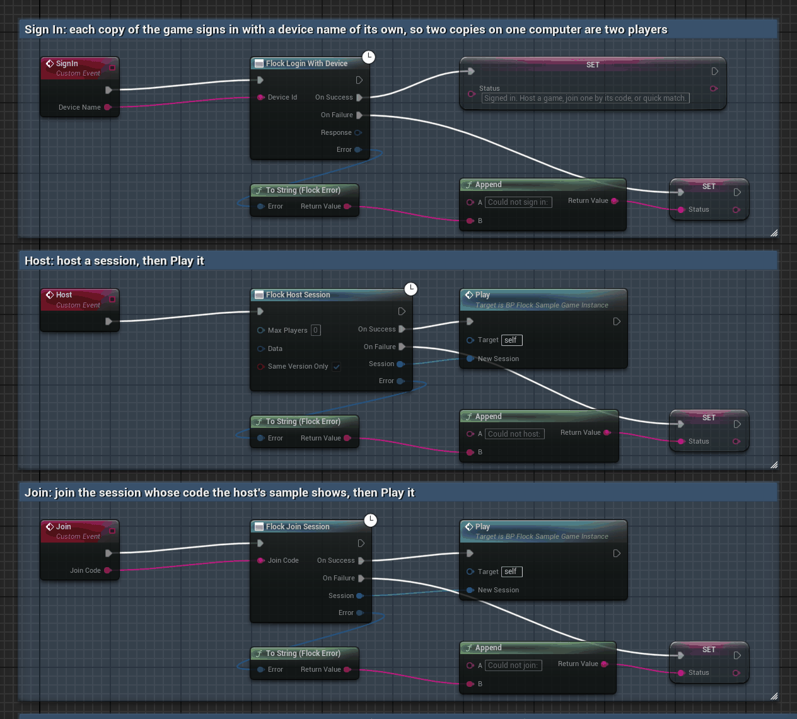
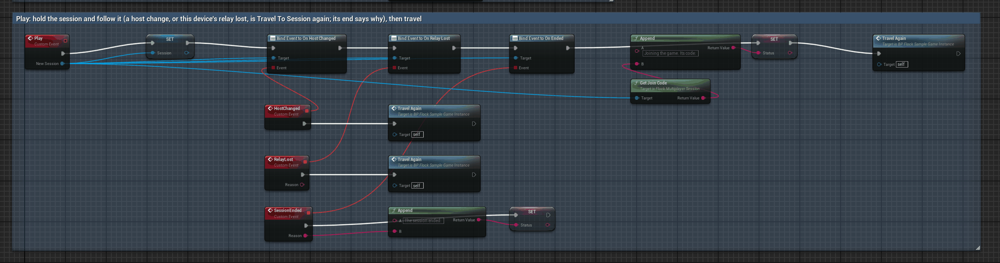
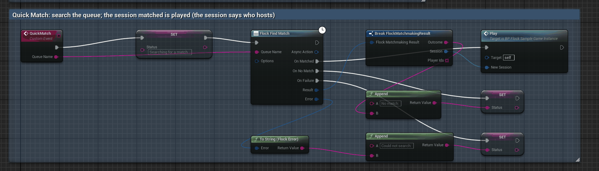

# Multiplayer

Flock's multiplayer is player-hosted: players group up in **parties**, find each other through **matchmaking** or a
join code, and one of them hosts the game session. This guide covers what ships today: **parties**, **sessions**,
**matchmaking**, **connecting players** directly, through **Flock's relay** for players who cannot reach each other directly,
or through a connection of the game's own, and the host **letting in only the session's players**.

Everything here goes through `FFlockMultiplayerProvider`, from `UFlockSubsystem::GetMultiplayerProvider()`. Make its
calls from the game thread. Every party, session and matchmaking call needs a signed-in player and fails with `Auth` when
there is none, without a request. From Blueprint, every call is a node under *Flock | Multiplayer*, and a ready-made game
mode lets in only the session's players: see [Blueprint](#blueprint).

## Parties

A party is a group of players who will search for a match together. Its **leader** made it, or was handed the lead;
the others joined with its **invite code**, which a player reads out or pastes to a friend. A player is in one party at
a time per game.

**A party lasts until the player leaves it, across launches.** Quitting the game does not leave it, and nothing times it
out on the server. So call `GetMyParty` after the player signs in: it hands back the party the player is still in, or
null.

```cpp
#include "FlockSubsystem.h"
#include "Multiplayer/FlockParty.h"

UFlockSubsystem* Flock = GetGameInstance()->GetSubsystem<UFlockSubsystem>();
FFlockMultiplayerProvider* Multiplayer = Flock->GetMultiplayerProvider();

// Make a party of up to 4 (the server's default when the size is left unset), with a setting of the game's own.
Multiplayer->CreateParty(4, FFlockCommandData().Set(TEXT("Mode"), TEXT("duo")),
    [this](TFlockResult<UFlockParty*> Result)
    {
        if (Result.IsSuccess())
        {
            Party = Result.Value;                  // a UPROPERTY, so the party outlives its end if you need it to
            ShowInviteCode(Party->GetInviteCode());
        }
    });

// A friend joins with the code, in any letter case.
Multiplayer->JoinParty(TypedCode, [this](TFlockResult<UFlockParty*> Result) { /* ... */ });

// After signing in: the party the player is still in, or null.
Multiplayer->GetMyParty([this](TFlockResult<UFlockParty*> Result) { /* Result.Value may be null */ });
```

| Call | Does |
|---|---|
| `CreateParty(MaxSize, Settings, OnComplete)` | Makes a party with the player as its leader and only member. Size 2 to 64; unset is 4. |
| `JoinParty(InviteCode, OnComplete)` | Joins by code. Joining the party the player is already in returns it. |
| `GetMyParty(OnComplete)` | The player's party, read now, or null. The same object each time while it lasts. |

Each call returns an `FFlockRequestHandle`; cancelling it stops the request on its way. A create or join the server had
already taken can still answer `Cancelled`, with the player now in the party: `GetMyParty` returns it. A cancel that lands
once the SDK holds the party (while it reads the player's search for a match, each call's last step) hands the party over
instead.

### The party object

`UFlockParty` is a Blueprint type; its state reads from Blueprint and C++ alike.

| Read | Gives |
|---|---|
| `GetId()`, `GetInviteCode()` | the party, and the code others join with |
| `GetLeaderPlayerId()`, `IsLeader()` | who leads, and whether it is the signed-in player |
| `GetMembers()` | the players, in the order they joined; when the leader leaves, the first of the others leads |
| `GetMaxSize()` | how many players it takes |
| `GetSettings()` | the game's own data, an `FFlockJsonData` read by dotted path (`TryGetString`, `TryGetInt`, ...) with its keys as written |
| `GetEndReason()`, `HasEnded()` | why it stopped being the player's, or `None` |

Its calls, each completing with the party as it stands afterwards:

| Call | Who | Does |
|---|---|---|
| `Leave(OnComplete)` | anyone | Leaves. If the server says the player is already out, that counts as leaving. The last one out disbands it. |
| `Kick(PlayerId, OnComplete)` | leader | Removes another player. The leader cannot remove themselves. |
| `MakeLeader(PlayerId, OnComplete)` | leader | Hands the lead to another player in the party. |
| `Update(MaxSize, Settings, OnComplete)` | leader | Changes the size, the settings or both; leave one unset to keep it. New settings replace all of the old ones, and the size cannot go below the players already in it. |
| `Disband(OnComplete)` | leader | Ends the party for everyone in it. |

A call on a party that has ended is refused (`Validation`) without a request. The server decides who may do what: a
member who does not lead gets `PartyNotPartyLeader`, a 403 that means "not allowed", never "signed out".

### Keeping it current

The SDK reads a held party again every **Party Refresh Seconds** (Project Settings > Plugins > Flock SDK Settings > Multiplayer; 10 by
default, about 6 requests a minute per player; 0 turns it off), after each change the game makes, and on every
`GetMyParty`. Only the newest reading changes the party: a reading sent before another one landed, or before one of
the game's own changes finished, changes nothing, so the party never steps back to an older state.

| Event | Raised when |
|---|---|
| `OnMembersChanged` | someone joined, left or was removed |
| `OnLeaderChanged` | another player leads now |
| `OnEnded(Reason)` | the party stopped being the player's, once |

Each is raised with the party already up to date, and is assignable from Blueprint. The end's reasons:

| `EFlockPartyEndReason` | Means |
|---|---|
| `Left` | the player left it, with `Leave`, even if a refresh saw it first |
| `Disbanded` | the player disbanded it |
| `Removed` | the server no longer lists the player in it: the leader removed them, it was disbanded, or they left it on another device |
| `SignedOut` | the player signed out or another player signed in. The party reads as ended at once, and `OnEnded` is raised on the next frame. The player is still in it on the server, so the next sign-in's `GetMyParty` returns it again. |

When Flock shuts down, a held party ends as `SignedOut` without raising anything. A refresh never takes up another party
the player is in: only a call the game makes does.

### Lost answers and sign-ins

Create, kick, make leader and disband are never sent twice after an answer that was lost: a second try could make a
second party or be refused for a change that already happened. Join, leave, update and the reads are tried again. Every
party request is sent only for the sign-in it was made under, so a retry never goes out as the next player.

### Common refusals

| Code | Means |
|---|---|
| `PartyAlreadyInParty` | the player is in a party already; `GetMyParty` returns it |
| `PartyInvalidInviteCode` | no open party has that code |
| `PartyFull` | no free places, or a size below the players already in it |
| `PartyNotPartyLeader` | only the leader can do that |
| `PartyCannotKickLeader` | the leader cannot remove themselves |
| `PartyTargetNotAMember` | that player is not in the party |
| `PartyNotFound` | the party is gone for this player; the SDK ends it as `Removed` |

Every refusal carries a hint naming the fix; see [Errors](errors.md).

## Sessions

A session is one game the players play together. Its **host** is the player whose game the others connect to; the host
made it, or was handed hosting when the host before them left. Other players take a seat with its **join code**. A player
holds one seat at a time per game: hosting or joining another session gives the old seat up.

```cpp
#include "FlockSubsystem.h"
#include "Multiplayer/FlockMultiplayerSession.h"

FFlockMultiplayerProvider* Multiplayer = GetGameInstance()->GetSubsystem<UFlockSubsystem>()->GetMultiplayerProvider();

// Host a session of up to 4 with data of the game's own; only players on this build's Game Version can join.
Multiplayer->HostSession(4, FFlockCommandData().Set(TEXT("map"), TEXT("dust")), /*bSameVersionOnly*/ true,
    [this](TFlockResult<UFlockMultiplayerSession*> Result)
    {
        if (Result.IsSuccess())
        {
            Session = Result.Value;                // a UPROPERTY, so the session outlives its end if you need it to
            ShowJoinCode(Session->GetJoinCode());  // then bring the players in: see Connecting players
        }
    });

// A friend joins with the code, in any letter case.
Multiplayer->JoinSession(TypedCode, [this](TFlockResult<UFlockMultiplayerSession*> Result) { /* ... */ });

// After a restart: the session the player is still seated in, or null.
Multiplayer->GetMySession([this](TFlockResult<UFlockMultiplayerSession*> Result) { /* Result.Value may be null */ });
```

| Call | Does |
|---|---|
| `HostSession(MaxPlayers, Data, bSameVersionOnly, OnComplete)` | Makes a session with the player as its host and only player. 2 to 16 players; unset takes the game's own player count from the dashboard (8 unless changed there). With `bSameVersionOnly` (the server's default) only players on the host's Game Version can join. |
| `JoinSession(JoinCode, OnComplete)` | Takes a seat by code. Joining the session the player is seated in returns it. |
| `GetSession(SessionId, OnComplete)` | Reads a session the player holds or once held a seat in. The held session comes back as the same object; one the player is no longer seated in comes back ended, and is not held. |
| `GetMySession(OnComplete)` | The session the player is seated in, found without its id, or null when seated nowhere. |

Each call returns an `FFlockRequestHandle`; cancelling it stops the request on its way.

### The session object

`UFlockMultiplayerSession` is a Blueprint type; its state reads from Blueprint and C++ alike.

| Read | Gives |
|---|---|
| `GetId()`, `GetJoinCode()` | the session, and the code others join with |
| `GetHostPlayerId()`, `IsHost()` | who hosts, and whether it is the signed-in player |
| `GetPlayers()` | the players seated now, longest seated first; when the host leaves, the first of the others hosts |
| `GetMaxPlayers()` | how many players it takes |
| `GetData()` | the game's own data, set when it was hosted, an `FFlockJsonData` with its keys as written |
| `HasConnection()`, `GetConnection()` | how to reach the host, as the host published it: a `Mode` and its `Values` |
| `GetEndReason()`, `HasEnded()` | why it stopped being the player's, or empty while it lasts |

Its calls, each completing with the session as it stands afterwards:

| Call | Who | Does |
|---|---|---|
| `Leave(OnComplete)` | anyone | Gives the seat up. If the server says the player is already out, that counts as leaving. When the host leaves, the longest seated of the others hosts; the last one out closes the session. |
| `End(OnComplete)` | host | Ends the session for every player. |
| `MakeHost(PlayerId, OnComplete)` | host | Hands hosting to another seated player, who then publishes their own connection. |
| `PublishConnection(Mode, Values, OnComplete)` | host | Says how to reach the host: a mode (32 characters at most) and the values it needs, under 4 KB in all. Replaces what was published before. |
| `RequestJoinToken(OnComplete)` | anyone | A token proving the player holds a seat, to send the host when connecting; good for 60 s. |
| `VerifyJoinToken(Token, OnComplete)` | host | Checks a token a connecting player sent and answers that player's id; refused with `MultiplayerInvalidJoinToken` when it is not good for this session. |

A call on a session that has ended is refused (`Validation`) without a request. The server decides who may do what: a
player who does not host gets `MultiplayerNotHost`, a 403 that means "not allowed", never "signed out".

Bringing the players' games together adds `TravelToSession`, `PublishDirectConnection`, `WaitForConnection` and
`FindDirectAddress`: see [Connecting players](#connecting-players).

### Keeping the seat, and keeping it current

While the player holds a session, the SDK keeps the seat with a **heartbeat** at the interval the server gives for the
game's timeouts (every 20 s at the defaults). Every session route answers the whole session, so each heartbeat's answer,
and each call's, brings the session up to date: the game needs no reads of its own to see players come and go. Only the
newest reading changes the session; one sent before another landed, or before one of the game's own changes finished,
changes nothing.

The server gives a seat up when it stops hearing from the player (90 s by default; 60 s for the host, after which hosting
moves on). Heartbeats run from the core ticker, which keeps ticking while a desktop game is minimized or covered; a game
that is paused past the timeouts loses its seat, and the first heartbeat back ends the session as `dropped`. A heartbeat
the server refuses for another reason stops with one warning; the next `GetSession` or `GetMySession` starts them again.

| Event | Raised when |
|---|---|
| `OnPlayersChanged` | a player took or gave up a seat |
| `OnHostChanged` | another player hosts now |
| `OnConnectionChanged` | the host published how to reach it, or published again, or hosting moved and the old address was cleared |
| `OnEnded(Reason)` | the session stopped being the player's, once |

Each is raised with the session already up to date, and is assignable from Blueprint. **When hosting moves, the old host's
address is cleared** until the new host publishes theirs, so `HasConnection()` is false meanwhile.

The end's reasons are strings, because the server can add more; compare with `FlockMultiplayerSessionEndReasons` and keep
a default:

| Reason | Means |
|---|---|
| `ended_by_host` | the host ended it |
| `host_left` | the host left and nobody was left to take over |
| `expired` | it reached the game's longest session age |
| `empty` | every player left |
| `left` | the player left it, with `Leave` or from another device; the game's own leave is `left` even when it closed the session |
| `dropped` | the server stopped hearing from the player and gave the seat up |
| `moved_to_another_session` | the player hosted or joined another session |
| `signed_out` | the player signed out or another player signed in. The session reads as ended at once, and `OnEnded` is raised on the next frame. |

A call that finds the player out of the session (`MultiplayerSessionNotFound`, `MultiplayerNotAParticipant`) reads the
session once to learn why, ends it with that reason, then fails with its own code.

### Quitting

When the game quits (its game instance shuts down, Play In Editor stopping included), the SDK gives the seat up on the way
out without waiting for the answer, so the others see the player go at once rather than when the server stops hearing from
them. The session ends as `left`, raising nothing. A game that shuts Flock down itself (`ShutdownSdk`) keeps the seat: the
session ends here as `signed_out` without raising anything, and after initializing again, within the game's timeouts,
`GetMySession` finds it.

### Lost answers and sign-ins

Host, end and make host are never sent twice after an answer that was lost: a second host would make a second session, and
a second end or hand-over would be refused. Join, leave, publish, the reads, heartbeats and the token calls are tried again.
Every session request is sent only for the sign-in it was made under, so a retry never goes out as the next player.

### Common refusals

| Code | Means |
|---|---|
| `MultiplayerInvalidJoinCode` | no open session has that code |
| `MultiplayerSessionFull` | no free seats |
| `MultiplayerVersionMismatch` | the session keeps to another Game Version |
| `MultiplayerNotHost` | only the host can do that |
| `MultiplayerTargetNotAParticipant` | that player holds no seat in it |
| `MultiplayerInvalidJoinToken` | a wrong, expired or other session's join token |
| `MultiplayerSessionNotFound` | the session is over, or the player holds no seat in it; the SDK ends it with the reason a reading gives |

## Matchmaking

Each mode of your game is a **queue** with a smallest and largest number of players, made in the Flock dashboard. A
player, or a whole party, searches in a queue by its name (letter for letter, case included); once the queue holds enough
players, Flock makes a match and seats the players in a session. A party is matched as one group and never split. Players
are matched in the order they search, and the longest waiting hosts. A search that ends without a match is an outcome,
not a failure.

```cpp
#include "FlockSubsystem.h"
#include "Multiplayer/FlockParty.h"

FFlockMultiplayerProvider* Multiplayer = GetGameInstance()->GetSubsystem<UFlockSubsystem>()->GetMultiplayerProvider();

Searching = Multiplayer->FindMatch(TEXT("coop-4"), FFlockMatchmakingOptions(),
    [this](TFlockResult<FFlockMatchmakingResult> Result)
    {
        if (!Result.IsSuccess())
        {
            // Cancelled when the game cancelled the handle (the search is cancelled on the server too);
            // MatchmakingQueueNotFound when no queue has that name.
            ShowLobby();
            return;
        }
        if (Result.Value.IsMatched() && Result.Value.Session != nullptr)
        {
            Play(Result.Value.Session);            // held like any other session: heartbeats, events, Leave
        }
        else if (Result.Value.Outcome == FlockMatchmakingOutcomes::Expired)
        {
            ShowMessage(TEXT("Nobody found in 5 minutes. Search again?"));
        }
        else
        {
            ShowMessage(TEXT("The search stopped."));
        }
    });

// The player gives up: the search is cancelled on the server, and the call completes as Cancelled.
Searching.Cancel();
```

Search as a party with the party's own `FindMatch`. The leader's game starts the search; another member's game hears it
through the party, so handle the result in one place. `OnSearchEnded` is raised on every member's game, the leader's
included, and before the `FindMatch` call waiting for that search completes.

```cpp
Party->OnSearchStarted.AddDynamic(this, &AMyLobby::ShowSearching);
Party->OnSearchEnded.AddDynamic(this, &AMyLobby::HandleSearchEnded);   // void HandleSearchEnded(const FFlockMatchmakingResult& Result)

if (Party->IsLeader())
{
    Party->FindMatch(TEXT("coop-4"), FFlockMatchmakingOptions(), nullptr);
}
```

| Call | Does |
|---|---|
| `FindMatch(QueueName, Options, OnComplete)` on the provider | Searches alone. A search of the player's own left from an earlier launch is cancelled first and this one takes its place. |
| `FindMatch(QueueName, Options, OnComplete)` on a party | The leader's game searches as the party. Another member's game waits for the leader's search (it may pass an empty name) and completes with the same match; it makes no search of its own. The wait ends (`Validation`) if the party ends first, or if the player comes to lead it: the new leader then searches with a queue name. |
| `IsSearching()` on a party | True while the party searches, as this game knows: its own `FindMatch`, or the leader's search seen by the party's refresh. |

Each `FindMatch` returns an `FFlockRequestHandle`. Cancelling it cancels the search on the server (a party's, for every
member) and completes the call as `Cancelled`; a match that landed while the cancel was on its way gives its seat up
first. `FFlockMatchmakingOptions::Attributes` passes your own data with a search, keys as written; matching does not use
it yet.

| Event on the party | Raised when |
|---|---|
| `OnSearchStarted` | the party started searching: the leader's game from its call, another member's from the party's refresh (**Party Refresh Seconds**) or its own `FindMatch` |
| `OnSearchEnded(Result)` | the party's search ended, with the same result the call gets |

A member's game learns of the leader's search from the party's refresh, so with Party Refresh Seconds at 0 it hears of it
only through its own `FindMatch`. A search from before the game first held the party is not told; the next one is.

### How a search ends

The SDK checks a search every 3 seconds (2.25 to 3.75, so players do not ask in step). `FFlockMatchmakingResult` holds how
it ended:

| `Outcome` | When |
|---|---|
| `FlockMatchmakingOutcomes::Matched` | `Session` is where the players play, held like any other session; `PlayerIds` lists them, the longest waiting first. `Session` is null when reading it failed (`GetMySession` finds it) or when "Create a session when a match forms" is off in the dashboard, which logs one warning a match; your game then makes the session itself. |
| `FlockMatchmakingOutcomes::Expired` | nobody was found within 5 minutes |
| `FlockMatchmakingOutcomes::PartyChanged` | a player joined or left the party during the search, so the server stopped it; the leader searches again |
| `FlockMatchmakingOutcomes::Cancelled` | another game stopped it: a party member's, or the player's own on another device |

The outcomes are strings, because the server can add more: compare with `IsMatched()` or the constants, and treat any
other as ended without a match. A party the player has left raises nothing more, though a call waiting on its search still
completes with how it ended.

### One search at a time

A player searches once at a time per game, in any queue. A second `FindMatch` while one runs here is refused
(`Validation`) without a request, and so is a second call waiting for the same party search. A search alone while the
player's party searches is refused `MatchmakingAlreadyQueued` and leaves the party's search alone: one member's cancel
would stop it for everyone.

### Sign-ins, quitting and shutting down

Every matchmaking request is sent only for the sign-in it was made under. When the player signs out or another player
signs in, the search ends as `Cancelled` on the next frame and nothing more is sent for it; it stays on the server until it
is matched or expires.

When the game quits (its game instance shuts down, Play In Editor stopping included), the search is cancelled on the way out
without waiting for the answer, so nobody who has gone is matched, and the call completes as `Cancelled`. A search still being
made is cancelled once its ticket lands, and a match already landing gives its seat up, while Flock waits for the requests on
their way. A game that shuts
Flock down itself (`ShutdownSdk`) ends the search here as `Cancelled` with no event and sends nothing; the next `FindMatch`
after initializing again replaces it.

### Common refusals

| Code | Means |
|---|---|
| `MatchmakingQueueNotFound` | no queue by that name in this game. The list of queues is read once a launch; a queue deleted and made again under the same name is found by its new id |
| `MatchmakingAlreadyQueued` | a player in the search already searches: the party's search, or a member searching alone |
| `MatchmakingPartyTooLarge` | the party has more players than the queue takes |
| `MatchmakingNotPartyLeader` | only the leader's game can queue the party; leadership moved before the search went out |
| `MatchmakingPlayerNotEligible` | a player is outside the queue's allowed segments |
| `MatchmakingVersionMismatch` | on a "Same game version only" queue, a member's game is on another Game Version, or has not read the party yet: each member's version comes from their game's last party read, so have every member's game call `GetMyParty` once it is running |

Every refusal carries a hint naming the fix; see [Errors](errors.md).

## Connecting players

Once the players hold a session (hosted, joined by code or matched), their games connect to the host's. There are two ways:

- **Over the engine's own networking**, directly or through Flock's relay: `TravelToSession` does it all. The host opens
  its level listening for players and publishes how to reach it; every other player waits for that and travels to the host
  with a Flock join token, which the host checks before letting the player in (its game mode calls Flock's check: see
  [Letting in only the session's players](#letting-in-only-the-sessions-players)). Players who cannot reach the host
  directly go through Flock's relay: see [Through Flock's relay](#through-flocks-relay).
- **A connection of the game's own** (Steam, EOS, anything else): the host publishes it with `PublishConnection(Mode,
  Values)`, and the players read it back from the session's `GetConnection()`.

```cpp
#include "FlockSubsystem.h"
#include "Multiplayer/FlockMultiplayerSession.h"

// Every player's game, host included, once it holds the session (a UPROPERTY on the game instance here).
FFlockTravelToSessionOptions Options;
Options.HostLevel = TEXT("/Game/Maps/Arena");   // the level the host opens; players travel to whatever the host has open
const TWeakObjectPtr<UMyGameInstance> Game = this;
Session->TravelToSession(this, Options, [Game](TFlockResult<FFlockTravelToSessionResult> Result)
{
    // Runs in the level the game is in now: the level the call was made from is gone.
    if (!Result.IsSuccess() || !Game.IsValid())
    {
        return;                                  // a mistake, a publish the server refused, or a cancel
    }
    const FString& Outcome = Result.Value.Outcome;
    if (Outcome == FlockTravelToSessionOutcomes::StartedAsHost || Outcome == FlockTravelToSessionOutcomes::Connected)
    {
        Game->ShowMatchStarting();
    }
    else
    {
        Game->ShowCouldNotJoin(Outcome);         // compare with FlockTravelToSessionOutcomes and keep a default
    }
});
```

Pass anything in the game's world as the first argument, such as an actor or the game instance. The completion runs once
the game is in the level it stays in, so capture what outlives a level change (the game instance, weak pointers), never an
actor of the level the call was made from.

### What Travel To Session does

| Who | Does |
|---|---|
| host | Opens `HostLevel` (empty: the level it is in, again, or for a player of the session that has become its host, the level it played with the old host) with the engine's `?listen`; a host already listening for the session keeps its level and its players. Once the level listens, opens its address on Flock's relay (unless `Relay` is Never) and publishes how to reach it on the port its net driver bound: when the port asked for is taken (another game on the same machine), the engine takes the next free one, and that is the one published. Completes `started_as_host`. |
| player | Waits for the host to publish (`WaitForHostSeconds`, 60 by default), reading the session every 2 s. Asks Flock for a join token (it lasts 60 s, so only once the host is known) and travels to the host's LAN address when this device shares the host's public address, through Flock's relay when the host offers it and this device is elsewhere (or the host did not answer on its network), and to the published address otherwise, with the token in the travel URL (`?FlockJoinToken=`). Completes `connected` once the host has let the player in: on a LAN, a few seconds after the host published (the next read of the session, then about two seconds of the engine's own connecting), and `refused` when the host turned the player away. |

How it ended is the result's `Outcome`, a string because more can come; compare with `FlockTravelToSessionOutcomes`:

| Outcome | Means |
|---|---|
| `started_as_host` | this game hosts: its level listens and how to reach it is published |
| `connected` | this game is in the host's level, let in by the host |
| `host_never_published` | the host did not publish within `WaitForHostSeconds`; this game traveled nowhere |
| `session_ended` | the session ended while this game waited |
| `could_not_connect` | connecting failed, and the engine has taken this game back to its default level; or the host published no address and port this game can use. Logged as a warning naming the address. Outside a LAN, a host that offers no relay must have its port forwarded to it |
| `could_not_start` | the host's level did not open listening for players on an IP address, so nothing was published |
| `not_direct` | the host published a connection of the game's own; the result's `Connection` holds it |
| `refused` | the host turned this player away, and the engine has taken this game back to its default level; the result's `RefusedReason` says why (see below). Logged as a warning naming the fix |
| `relay_failed` | Flock's relay was needed and could not be used; the result's `RelayFailureReason` says why (see [Through Flock's relay](#through-flocks-relay)). A host with Relay Always stops listening |
| `restarted` | the game called Travel To Session again before this one ended, and the newer one took over: nothing to do, its answer follows |

It fails, rather than ending with an outcome, only for a mistake (no world, an ended session, this game connected to another
session's host or to a server of its own, hosting another session, a level the engine is still opening 30 s on, a player's
`WaitForHostSeconds` of zero or less), for a publish the server refused (a host stops listening on a level it opened for this travel:
nobody can reach a host that did not say where it is), for a join token Flock would not give (nothing travels without one;
the failure is Flock's, with its fix), and for a cancel. **Cancelling the handle** gives up a player's join token still
being asked for or connection still being made (the game stays in its level) and stops a host listening on a level this
travel opened, at once or as soon as it has opened; a host that kept the level it was listening on keeps it listening.
**Calling it again** while one is under way ends that one `restarted` and begins once the engine has settled; a level the
engine is opening, a connection it is making, or a seamless travel is waited for (at most 30 s), and a level the restarted
travel opened stays for the newer one.

A connection the engine cannot make is the engine's to give up: it waits out its own connection timeout (about 20 s for an
address nobody answers), then loads the game's default level. Travel To Session connects over the engine's IP networking:
a game whose net driver uses Steam's sockets (OnlineSubsystemSteam's `bUseSteamNetworking`, on unless set to false) cannot
listen on an IP address, and ends `could_not_start`; such a game publishes a Steam connection of its own instead.

### Through Flock's relay

Players on different networks rarely reach a host directly: its router lets in nothing it was not told to forward. Flock's
relay carries their packets instead, and Travel To Session uses it with the game's networking code unchanged: the engine's own
net driver keeps its socket, its handshake and its level changes, and the SDK stands in for the other side on this device's
loopback. A relayed player's game travels to 127.0.0.1 on a port of the SDK's; a host gets each relayed player from a loopback
port of its own, so the engine sees one connection a player.

`Options.Relay` (`EFlockRelayUse`) says who goes through it. Set it the same on every player of a game:

| Relay | The host | A player |
|---|---|---|
| `WhenNeeded` (default) | opens its address on the relay and publishes it with its own addresses | on the host's network (it shares the host's public address): connects to the host's LAN address, and through the relay when the host does not answer there within 3 s; anywhere else: through the relay |
| `Always` | publishes its relay address alone, and turns away any player that reaches it another way (`relay_only`, without asking Flock) | through the relay, on the host's network too |
| `Never` | opens no relay and publishes directly | connects to the address the host published; a host that takes players through the relay alone cannot be reached (`could_not_connect`, said in the log) |

A player reserves its own address on the relay server the host is on, says it for its seat, and the host lets in each seated
player's relay address, reading the session every 2 s while it takes players through the relay; a host's check then lets in
only players whose join token checks out, exactly as directly, and `PlayerForConnection` says who each relayed connection is.
The result's `bThroughRelay` says whether the travel went through the relay. When the relay was needed and could not be used,
the travel ends `relay_failed`, and `RelayFailureReason` says why:

| Relay Failure Reason | Means |
|---|---|
| `relay_not_offered` | Flock lists no relay: switched off for this game in the Flock dashboard, or none set up |
| `relay_not_offered_by_host` | this player's Relay is Always, and the host takes nobody through the relay (its Relay is Never, or its relay could not be opened) |
| `relay_server_not_listed` | Flock does not list, for this player, the relay server the host is on |
| `relay_paused` | the studio's relay is paused until its bill is paid |
| `relay_too_many_logins` | more than 12 requests for relay logins a minute, or the seat drew the most logins one seat may (10) |
| `relay_not_in_session` | Flock says the player has no seat in the session |
| `flock_unreachable`, `relay_logins_refused` | Flock did not answer the request for relay logins, or refused it for another reason |
| `relay_unreachable`, `relay_wrong_login`, `relay_full`, `relay_open_refused`, `relay_refused` | the relay server could not be reached, refused the login, had no room, would not let the host's packets in, or refused for another reason |
| `relay_lost`, `relay_closed` | the relay let the address go or has answered nothing for 45 s (this device's packets no longer reach it), or it was closed (the session's end) |
| `relay_no_thread` | the relay needs threads of its own, and this launch runs without threads (`-nothreading`) |

Each reason carries its own fix in the warning the log shows. A host whose relay cannot be opened publishes directly under
When Needed (saying why, unless the relay is switched off for the game) and stops hosting under Always (`relay_failed`).

What to know about relayed play:

- A host takes at most 64 relayed players. A relay address the host's check has not let in within 30 s gives its place back
  once a new one is heard, so nobody else on the relay can hold every place.
- The relay carries packets up to 1400 bytes; the engine's own are at most 1024. Larger packets are dropped, with one warning.
- A host's level change without seamless travel brings every player back through a new connection, carrying the join token
  of its first travel, which lasts 60 s. So while a player is in its host's game, relayed or not, Travel To Session keeps a
  fresh join token on hand (it asks Flock for a new one once the one it holds has less than 20 s left: about one request every
  40 s), and puts it on that connection before it logs in. Nothing is asked of the game. When no token on hand is good (Flock
  could not give one), a new one is asked for that connection; one that comes after the host has taken the player back (its net
  driver's `ServerTravelPause`, 4 s by default) is too late, and the log says the first token went.
- A relay connection holds `mode` `relay`, the direct values above when the host's Relay is When Needed, and two more:

| Value | Holds |
|---|---|
| `relay_address` | the host's address on the relay, `a.b.c.d:port` |
| `relay_server` | the relay server it is on, `name:port` |

### Letting in only the session's players

A host that travels to its session with `TravelToSession` lets in only players whose Flock join token checks out, one
connection a player, and knows which Flock player each connection is. The engine asks the game mode about each joining
player in `PreLoginAsync`, so the host's game mode calls Flock's check there, in place of the engine's own:

```cpp
// MyGameMode.h
virtual void PreLoginAsync(const FString& Options, const FString& Address, const FUniqueNetIdRepl& UniqueId,
    const FOnPreLoginCompleteDelegate& OnComplete) override;

// MyGameMode.cpp
#include "Multiplayer/FlockJoinChecks.h"

void AMyGameMode::PreLoginAsync(const FString& Options, const FString& Address, const FUniqueNetIdRepl& UniqueId,
    const FOnPreLoginCompleteDelegate& OnComplete)
{
    // Flock's check, then the engine's own (PreLogin, such as a full game), then the game's own below.
    const TWeakObjectPtr<AMyGameMode> Mode = this;
    FlockJoinChecks::CheckJoiningPlayer(this, Options, Address, UniqueId, OnComplete,
        [Mode](const FFlockJoiningPlayer& Player, FString& OutRefusedReason)
        {
            if (Mode.IsValid() && Mode->IsBanned(Player.PlayerId))
            {
                OutRefusedReason = TEXT("banned");   // the joining player's RefusedReason
                return false;
            }
            return true;
        });
}
```

Or base the game mode on **`AFlockGameModeBase`** (on `AGameModeBase`) or **`AFlockGameMode`** (on `AGameMode`, for
match states), as a Blueprint or in C++: their `PreLoginAsync` does exactly the above, and the game's own check is their
**Approve Joining Player** (`ApproveJoiningPlayer`), overridable in Blueprint, which lets everyone in until overridden.

The game's own check is optional; it runs only for a player Flock has let in, and gets `FFlockJoiningPlayer`: the
`PlayerId` Flock verified, the travel URL's `Options` without Flock's token, the `Address` (127.0.0.1 for a player that came
through Flock's relay) and the `UniqueId` the engine gave. A refusal with no reason is told as `refused_by_the_game`. `OnComplete` is always called, and the game thread never
waits: the answer comes once Flock has answered.

Who a connection is, on the host: `Session->PlayerForConnection(PlayerController)`, such as in `PostLogin`. It answers the
Flock player Flock verified for a joined player, this device's own player for its own controller, and an empty string for a
controller whose connection is gone or was not let in by Flock's check, and while the game does not host that session
through `TravelToSession`. Name players by it, never by what a player sends.

A joining player is turned away for each of these reasons, its `RefusedReason`:

| Reason | Means |
|---|---|
| `no_join_token` | the player's travel URL carried no token: it did not come through `TravelToSession`. Flock is not asked |
| `join_token_invalid` | Flock said the token is not good for this session: made up, another session's, expired (tokens last 60 s), or its player gave up their seat. Flock gives one answer for all four |
| `already_connected` | the same Flock player is already let in through another connection the host hears from. A token checks out any number of times within its 60 s, so the host itself lets one connection a player in; a connection that is gone, or that was turned away, holds no place. One the host has heard nothing from for 5 s (a lost relay, a game that stopped) gives way to the player's newer one once that is let in, and is closed; a newer one that comes sooner waits up to 5 s while the earlier stays quiet. The newer must bring a join token of its own (Travel To Session asks for one each time): the earlier connection's own token, which travels in the clear, never takes its place |
| `flock_unreachable` | Flock did not answer within 8 s, or its answer could not be read, or the host was over its checks a minute (60 by default; the server answers `RequestRateLimited`). Nobody is let in unchecked; the host's log says why |
| `session_ended` | the session has ended |
| `not_host` | the device reached no longer hosts the session |
| `refused_by_the_game` | the game's own check turned the player away without a reason of its own |
| `join_check_missing` | the host's game mode does not call `CheckJoiningPlayer`, so nobody is let in. The host's log says so once, at Error |
| `relay_only` | the host takes players through Flock's relay only (its Relay is Always), and this player reached it another way. Flock is not asked |

`RefusedReason` can also be the game's own reason (`banned` above) or the engine's (such as `Server full.`); compare with
`FlockTravelToSessionRefusedReasons` and keep a default. A player turned away by a host that is not checking through Flock
(its words carry no Flock reason), or by a host closing its connections, ends `could_not_connect`.

How long a check may take: the engine never drops a player its game mode has not answered (measured: still waiting after
130 s), so Flock's check gives Flock 8 s and then turns the player away with a reason. An answer that comes after the player
left, or after the host stopped hosting, lets nobody in and is remembered nowhere; when the host's level stops listening or
Flock shuts down, every player still being checked is turned away (`flock_unreachable`) rather than left waiting. Flock shut
down while the hosted level stays open (listening, or opening) turns every joining player away (`flock_unreachable`, told once
as a warning), whatever the game mode does, until that level closes or the game opens another: nobody can be checked, so
nobody is let in. Leave the hosted level before shutting Flock down.

While the game does not host through `TravelToSession`, `CheckJoiningPlayer` is the engine's own `PreLoginAsync` and the
game's check is not run. Split-screen guests joining through a player's connection carry no token of their own, so a host
checking players turns them away (`no_join_token`). The token travels in the clear unless the game encrypts its
connections; it is bound to one player and one session for 60 s, and the host lets in one connection a player.

### When the host changes

When the host leaves or its game stops, Flock makes the player seated longest the host and raises **On Host Changed** on every
game. The engine cannot move a running game to a new host, so each game calls Travel To Session again with the same options:
the new host hosts, and the others join it. Do the same on **On Relay Lost**, raised once when this device's address on Flock's
relay stops working (its reason a `FlockRelayFailureReasons` value), and on a player when its host publishes another relay
address (the host's own relay was lost), since the player's relay no longer reaches it. A new host's address is On Host
Changed's alone.

```cpp
// MyGameInstance.cpp: once the session is held.
Session->OnHostChanged.AddDynamic(this, &UMyGameInstance::PlayAgain);
Session->OnRelayLost.AddDynamic(this, &UMyGameInstance::PlayAgainAfterRelayLost);

void UMyGameInstance::PlayAgain()
{
    if (!Session->HasEnded())
    {
        Session->TravelToSession(this, TravelOptions, [](TFlockResult<FFlockTravelToSessionResult> Result)
        {
            // restarted: a newer call took over, and its own answer follows.
        });
    }
}

void UMyGameInstance::PlayAgainAfterRelayLost(const FString& Reason)
{
    PlayAgain();
}
```

Called again for the session the game plays, Travel To Session does this device's part from wherever the game is:

| This game was | Now | Travel To Session |
|---|---|---|
| the host | still the host | keeps its level and its players, opens its relay address again when it was lost, and publishes again; a refused publish, a cancel or a newer call leaves the level listening |
| the host | a player | stops listening (its players' connections close), waits for the new host, and joins it |
| a player | the host | opens the level it played with the old host listening, unless `HostLevel` names another (the engine may have taken it back to its default level when the old host went), and publishes |
| a player | a player | waits for the new host in the level it is in, then connects; the engine closes the old connection as it sets off |
| a player in the host's game | a player, the same host | answers `connected` at once and keeps its connection: a level's Begin Play that calls it runs on every player that arrives |

Games hear On Host Changed within about 20 s of a host leaving (the next heartbeat brings the change) and are back in the new
host's game about 10 s later (measured with three players through the relay: told 18 s on, back 31 s on); a host's game that stops
without leaving is replaced a little over a minute on (Flock's host timeout of 60 s, then its sweep; measured: told 65 s on, back
80 s on). Everything the old host held is gone: its
actors, its game state and its level's state. Keep what a new host needs on every player, and rebuild from it.

A player's connection to a host that went without a word is the engine's: it times out (a minute by default) and the engine
raises **NetworkError** and takes the game back to its default level. Calling Travel To Session again from the Game Instance's
NetworkError event, while the session lasts, takes the player back to the session's host, whoever that is by then. A host lets
a player's newer connection in once it has heard nothing from the earlier one for 5 s, with the new join token Travel To
Session brings.

### The pieces

`TravelToSession` is built from three session calls a game can also use alone, with engine travel of its own:

| Call | Who | Does |
|---|---|---|
| `PublishDirectConnection(Port, OnComplete)` | host | Publishes how to reach this device on `Port`, the port its game listens on. Refused (`Validation`) before any request for a port outside 1 to 65535. |
| `WaitForConnection(TimeoutSeconds, OnComplete)` | player | Completes with the session once the host has published (`HasConnection()`), once the session has ended (`HasEnded()`), or with neither when the time runs out. Reads the session every 2 s meanwhile; a host change clears the address without ending the wait. Completes at once when the host has already published. |
| `FindDirectAddress(OnComplete)` | player | The address and port to connect to (`FFlockDirectAddress`): the host's LAN address when this device shares its public address, the published address otherwise. `Address` is empty when the host published no dotted IPv4 address and whole port from 1 to 65535 (a port sent as text, "7777", counts). |

A direct connection holds `mode` `direct` and four values; the server checks none of them, so the SDK does:

| Value | Holds |
|---|---|
| `address` | the host's public address when it is known, its LAN address otherwise |
| `port` | the port, a number |
| `lan_address` | the address the host's game sends from toward the internet; left out when unknown |
| `public_address` | the address the host is seen from on the internet; left out when unknown |

The public address comes from one request to the STUN server Flock lists (`stun.l.google.com` unless the game's backend
lists another), asked from a dual-stack socket where the platform makes one, a plain IPv4 socket otherwise. Flock's list is
read once a launch, asked with no session so a direct connection is never counted as relay use; a list that cannot be read is
not kept, and is warned about. When no STUN server answers within 2 s, the connection offers the LAN address alone, which
only players on the same network can reach, with one warning per launch.

### A connection of the game's own

```cpp
// Host: say how to reach it on Steam. The mode is the game's own word, 32 characters at most.
Session->PublishConnection(TEXT("steam"), FFlockCommandData().Set(TEXT("steam_id"), MySteamId), nullptr);

// Players: TravelToSession ends not_direct holding it; or read it whenever OnConnectionChanged says it changed.
FString HostSteamId;
if (Session->HasConnection() && Session->GetConnection().Mode.Equals(TEXT("steam"), ESearchCase::CaseSensitive)
    && Session->GetConnection().Values.TryGetString(TEXT("steam_id"), HostSteamId))
{
    ConnectThroughSteam(HostSteamId);
}
```

### Outside a LAN

Players on other networks reach a direct host only when its port is forwarded to it on the host's router. Flock's relay needs
no forwarding, and Travel To Session uses it for them by default: see [Through Flock's relay](#through-flocks-relay).

## The multiplayer sample

The plugin's **Content/Samples/Multiplayer** folder (turn on **Show Plugin Content** in the Content Browser's settings) holds a
sample made of Blueprints only, with no C++ of its own. Every Flock call in it is a node, so it reads as the Blueprint version of
this guide:

| Asset | What it is |
|---|---|
| `BP_FlockSampleGameInstance` | The Game Instance. Its Event Graph signs in with a device name, hosts, joins by code, quick matches, holds the session, calls **Flock Travel To Session**, calls it again on **On Host Changed** and **On Relay Lost**, gives the seat up when a travel does not get in, and leaves. Its **Status** says what it is doing. |
| `WBP_FlockMultiplayerSample` | A card in the screen's corner with a field and a button for each, and the Game Instance's status line. |
| `FlockMultiplayerSample` | The level. Its World Settings run **Flock Game Mode Base**, so its host lets in only the session's players; its Level Blueprint shows the widget. |



To try it:

1. In **Project Settings > Maps & Modes**, set **Game Instance Class** to `BP_FlockSampleGameInstance`. Travel To Session runs in
   the Game Instance because its pins fire once the level has changed; until it is set, the widget says so.
2. Open the `FlockMultiplayerSample` level and start two standalone games of it (**Play > Standalone Game**, twice), or run a
   packaged build twice.
3. In each game, type a different device name and press **Sign In**: two copies on one computer would otherwise be one player.
4. Press **Host** in one; type the code its status shows into the other and press **Join**. Or press **Quick Match** in both, with
   the name of a queue your game has in the Flock dashboard.
5. **Leave** gives the seat up and opens the sample's level again, on its own.

The sample uses Travel To Session's default options (Relay When Needed), so a friend on another network joins through Flock's
relay. To build on it, copy the folder into your project's Content and change the copies.

How it works: each button of the widget calls an event of the Game Instance, and each event is one row of nodes in the Game
Instance's Event Graph, under a comment saying what it does. Sign In, Host and Join each call one node and say how it went;
Host and Join end in **Play** with the session they got:



**Play** holds the session, binds its **On Host Changed** and **On Relay Lost** to Travel Again and its **On Ended** to a status
line, then travels:



**Travel Again** is **Flock Travel To Session** for the session held, while it lasts. A travel that does not get in because a
newer one took over (Outcome **Restarted**) needs nothing; any other gives the seat up, saying why:


Quick Match searches the queue its field names and plays the session matched:



## Blueprint

Every call above is an async node under *Flock | Multiplayer*, named as the call is, and fires exactly one of its pins. The
party and session objects' state and events are already Blueprint (a party's **On Members Changed**, a session's **On Ended**,
**On Host Changed**, **On Relay Lost** and the rest); the nodes add the calls.

| Node | Pins |
|---|---|
| Flock Create Party, Flock Join Party | On Success (the party) · On Failure (the error) |
| Flock Get My Party | On Party · On No Party · On Failure |
| Flock Leave Party, Kick From Party, Make Party Leader, Update Party, Disband Party | On Success (the party as it stands, ended after a leave or disband) · On Failure |
| Flock Host Session, Flock Join Session, Flock Get Session | On Success (the session) · On Failure |
| Flock Get My Session | On Session · On No Session · On Failure |
| Flock Leave Session, End Session, Make Session Host, Publish Connection, Publish Direct Connection | On Success (the session) · On Failure |
| Flock Find Match, Flock Party Find Match | On Matched (the result: its Session is where the players play) · On No Match (the result: its Outcome says how the search ended) · On Failure |
| Flock Request Join Token | On Success (the token) · On Failure |
| Flock Verify Join Token | On Success (the player the token was given to) · On Failure |
| Flock Find Direct Address | On Success (the address) · On Failure |
| Flock Wait For Connection | On Connection · On Session Ended · On Timed Out · On Failure |
| Flock Travel To Session | On Joined (started as host, or connected) · On Not Joined (the result's Outcome and Refused Reason say why) · On Failure (a mistake, such as an ended session) |

Max Size and Max Players left at 0 take the server's default (a party of 4) and the game's own count from the dashboard;
Update Party's New Max Size 0 keeps the size, and its Replace Settings off keeps the settings. A node that acts on a party or
a session and is given none fires On Failure and sends nothing. On No Match and On Not Joined carry outcomes the server adds
later too, so compare the result's Outcome with the nodes below and keep a default.

**Cancelling.** Find Match, Party Find Match, Wait For Connection and Travel To Session hand out the node itself on their
**Async Action** pin; its **Cancel** stops the search on the server, the wait, or the travel. A cancel the game asks for fires
no pin; Flock shutting down while a node waits fires On Failure. The game instance keeps every node until a pin has fired, so
a search left running by a graph that called the node again still answers.

**Call Travel To Session from the Game Instance Blueprint**, where the engine's own **NetworkError** and **TravelError**
events are. Its pins fire once the level has changed, so a widget or an actor of the current level is gone by then and never
sees how the travel ended: a refused player included, since the engine takes it back to its default level. Called from inside
the level, the node warns in the log, naming the caller. **When the host changes**, bind the session's On Host Changed and On
Relay Lost there too, each to Flock Travel To Session with the same Options (see [When the host changes](#when-the-host-changes)):
the travel it replaces fires On Not Joined with the Outcome Restarted, which needs nothing done.

**Spellings.** Every value a result can carry is a pure node, so a graph compares rather than types it: **Flock Travel Outcome**
(Started As Host, Connected, Host Never Published, Session Ended, Could Not Connect, Could Not Start, Not Direct, Refused,
Relay Failed, Restarted), **Flock Refused Reason** (No Join Token, Join Token Invalid, Already Connected, Flock Unreachable, Session
Ended, Not Host, Refused By The Game, Join Check Missing, Relay Only), **Flock Relay Failure** (Not Offered, Not Offered By
The Host, Server Not Listed, Paused, Too Many Logins, Not In Session, Flock Unreachable, Logins Refused, Unreachable, Wrong
Login, Full, Open Refused, Refused, Lost, Closed, No Thread), **Flock Matchmaking Outcome** (Matched, Expired, Party Changed,
Cancelled), **Flock Session End Reason** (Ended By Host, Host Left, Expired, Empty, Left, Dropped, Moved To Another Session,
Signed Out), **Flock Connection Mode Direct** and **Relay**, **Flock Direct Connection Value** (Address, Port, LAN Address,
Public Address), **Flock Relay Connection Value** (Relay Address, Relay Server), and **Is Matched**. Travel To Session's
Options carry **Relay** (When Needed, Always or Never).

**Letting in only the session's players.** Make the game's game mode a Blueprint based on **Flock Game Mode Base** (or **Flock
Game Mode**, for match states) and set it in the project's Maps & Modes. To turn players away, override **Approve Joining
Player**: it gets the Joining Player (the Player Id Flock verified, the travel's Options, the Address) after Flock's check and
the engine's own, returns whether to let the player in, and its Refused Reason reaches the player's Travel To Session (empty
reads as Refused By The Game). Name players by **Player For Connection** on the session, such as in **OnPostLogin**.
