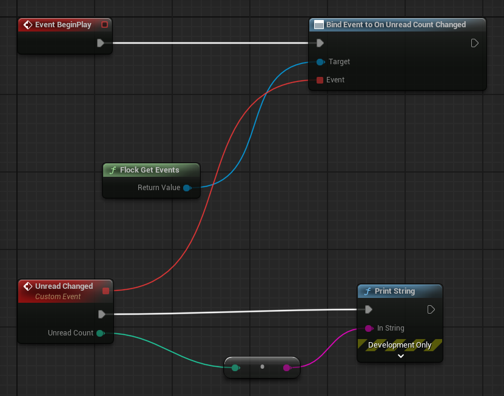

# Notifications

Three things share one provider, and they are independent of each other:

- **The inbox** — messages the backend has already delivered to this player. Needs no push setup at all.
- **Scheduling** — reminders your game asks the backend to deliver later. Server-side, so they fire whether
  or not the game is running.
- **Push device tokens** — registering a device so the backend can reach it outside the game.

Reach them from `UFlockSubsystem::GetNotificationProvider()`, or use the Blueprint nodes under
**Flock | Notifications** (see [Blueprint](#blueprint)). In the C++ samples below, `Notifications` is that provider:

```cpp
#include "FlockSubsystem.h"
#include "Providers/FlockNotificationProvider.h"

// From any actor, widget or the game instance.
FFlockNotificationProvider* Notifications = UFlockSubsystem::Get(this)->GetNotificationProvider();
```

Every call to the server except the two template reads requires a signed-in player and fails with
`EFlockErrorType::Auth` without one — an inbox and a device token both belong to a player.

## The inbox

```cpp
Notifications->GetNotifications([](TFlockResult<FFlockNotificationPage> Result)
{
    if (!Result.bSuccess) { return; }
    // Result.Value.Items is this page; Result.Value.Total is the player's whole inbox.
});
```

`GetNotifications(bUnreadOnly, Page, Limit, ...)` takes the filter and paging explicitly; the short overload
is everything, first page of 50.

For a bell icon, prefer `GetSummary` — it returns the unread count *and* the newest few items in one call:

```cpp
Notifications->GetSummary([](TFlockResult<FFlockNotificationSummary> Result)
{
    // Result.Value.UnreadCount, Result.Value.Items
});
```

`GetUnreadCount` is the cheapest call if you only need the badge number.

Marking read:

```cpp
// Notification: one row of an inbox page or a summary (FFlockNotification).
Notifications->MarkRead(Notification.Id, nullptr);   // one row; returns the updated row
Notifications->MarkAllRead(nullptr);                 // Updated is how many actually flipped
```

Read state comes from `FFlockNotification::IsRead()` (`Is Read` in Blueprint), never from comparing
`ReadAt` yourself — it is nullable on the wire and an absent value arrives as an empty string.

`Type` and `Severity` are plain strings rather than enums, because the API declares both unconstrained; an
enum here would invent a closed set the server never promised. `Data` is an `FFlockJsonData` handle with the
sender's keys kept verbatim — read it with the JSON Data library.

**Offline.** Inbox reads are snapshot-backed, so a notifications screen shows the last-known messages when
the network is down rather than an error. Mark-read calls are the opposite: they are **never** queued
offline and fail with `Connection` instead, because a read receipt replayed an hour later marks messages the
player never saw.

**`ClearCache()` clears for one player.** It drops the signed-in player's cached inbox, counts and summary,
and nothing else. Another account on the same device keeps its own — including its pending reminders, which
matters because a scheduled notification still fires server-side and its id is the only handle on it. The
seen-watermark and the pending-schedule list are state rather than cache and are kept for the signing-out
player too; the template catalog is game-scoped and is kept for everyone. Called with nobody signed in it
does nothing at all.

### Reacting to arrivals

Two events on the hub save you diffing pages yourself. Each handler is a `UFUNCTION()` of your class with the event's
parameters:

| Event | Handler | Raised |
|---|---|---|
| `OnUnreadCountChanged` | `void HandleUnreadCount(int32 UnreadCount)` | with the count the server last reported |
| `OnNotificationReceived` | `void HandleNotification(const FFlockNotification& Notification)` | once for each notification not seen before |

```cpp
// MyActor.h
UFUNCTION()
void HandleUnreadCount(int32 UnreadCount);

UFUNCTION()
void HandleNotification(const FFlockNotification& Notification);

// MyActor.cpp
#include "FlockSubsystem.h"
#include "FlockEvents.h"

void AMyActor::BeginPlay()
{
    Super::BeginPlay();
    UFlockEvents* Events = UFlockSubsystem::Get(this)->GetEvents();
    Events->OnUnreadCountChanged.AddDynamic(this, &AMyActor::HandleUnreadCount);
    Events->OnNotificationReceived.AddDynamic(this, &AMyActor::HandleNotification);
}

void AMyActor::HandleUnreadCount(int32 UnreadCount)
{
    UE_LOG(LogTemp, Display, TEXT("Unread: %d"), UnreadCount);   // the bell's badge
}

void AMyActor::HandleNotification(const FFlockNotification& Notification)
{
    UE_LOG(LogTemp, Display, TEXT("%s: %s"), *Notification.Title, *Notification.Body);
}
```

In Blueprint, drag off **Flock Get Events** and **Bind Event to On Unread Count Changed** (or On Notification Received):



Bind before the first read: the events ride the reads and are raised only to what is bound by then.

`OnUnreadCountChanged` carries the count the **server** last reported — it fires on `GetUnreadCount`,
`GetSummary`, and `MarkAllRead` (which reports `0`, since that call has exactly one possible outcome). It
never fires from a background poll, because the SDK does not run one.

`OnNotificationReceived` fires once per notification the SDK has not surfaced before, **oldest first**. It
rides the inbox and summary reads and adds no traffic of its own.

Things worth knowing about it:

- **"Received" means first seen by a read**, not the instant the server created the row. There is no
  realtime channel; a push wakes the OS, not your `UObject`.
- **The first read for a player is silent.** A player who already has mail would otherwise get their whole
  history as a burst of events the first time your game asks.
- **It survives a sign-out.** The watermark behind it is per-player state rather than cache, so signing out
  and back in does not re-announce everything, and a shared device never applies one account's cutoff to
  another's inbox.
- A row whose `created_at` the SDK cannot parse is skipped rather than announced — with no comparable
  timestamp it would raise on every fetch, and a duplicate is worse than a miss.

## Scheduling

```cpp
Notifications->ScheduleByTemplateName(TEXT("energy_refilled"),
    FDateTime::UtcNow() + FTimespan::FromHours(4),
    FFlockCommandData().Set(TEXT("player"), TEXT("Ada")),
    { EFlockNotificationChannel::Push },
    [](TFlockResult<FFlockScheduledNotification> Result) {});
```

The first argument is the template's **name** — what you see on the dashboard — not its ID. The ID is
resolved through the by-name route and memoized for the session, so scheduling repeatedly does not
re-resolve. An unknown name fails `Validation` before anything is scheduled.

`Variables` fills the template's `{placeholders}`; keys are the template's own and are sent verbatim.
`Channels` restricts delivery. Leave either empty and it is **omitted from the request** rather than sent
blank, so the template's own defaults apply — an empty channel list would otherwise read as "deliver
nowhere".

Cancel with the id from the scheduled row:

```cpp
// Scheduled: the FFlockScheduledNotification that ScheduleByTemplateName completed with, or a row of GetScheduled.
Notifications->CancelScheduled(Scheduled.Id, nullptr);
```

Delivery state is read from the timestamps, not the `Status` string: `IsPending()`, `IsDelivered()`,
`IsCanceled()`. A status value added server-side later cannot silently break those.

**Money-adjacent safety.** `ScheduleByTemplateName` is **not idempotent** and is never re-sent after an
ambiguous failure — a retry could leave the player with two of the same reminder. `CancelScheduled` *is*
idempotent and does retry.

`ScheduleByTemplateId` exists for a caller that already holds an id. It is named rather than overloaded,
because two `FString` overloads would be indistinguishable at a call site.

### What is scheduled

Ask the server. `GetScheduled` reads the player's schedules as the backend knows them, which means it sees
reminders set before a reinstall or on another device:

```cpp
Notifications->GetScheduled([](TFlockResult<FFlockScheduledNotificationPage> Result)
{
    for (const FFlockScheduledNotification& Entry : Result.Value.Items)
    {
        // Entry.Id is what CancelScheduled takes.
    }
});

// Or filter explicitly. Status is a string, not an enum — the server owns the set.
Notifications->GetScheduled(FlockScheduledNotificationStatuses::Delivered, /*Page*/ 1, /*Limit*/ 100,
    [](TFlockResult<FFlockScheduledNotificationPage> Result) { /* Result.Value.Items, as above */ });

Notifications->CancelAllScheduled([](TFlockResult<int32> Result)
{
    // Result.Value is how many the server actually cancelled.
});
```

In Blueprint this is **Flock Get Scheduled Notifications**, whose `Status` pin defaults to pending. Feed it
from *Flock Schedule Status Pending / Delivered / Canceled* rather than typing the value — note the wire
spelling is the single-l `canceled`.

`GetScheduled` is **never cached**. A schedule is delivered server-side with nothing to tell the client, so
a stored page would report a reminder that has already fired as still pending — wrong rather than stale.
It needs a network, and it needs a signed-in player.

`CancelAllScheduled` cancels **what the server lists**, so it also clears reminders this install never
created. It drops entries the server no longer recognises — delivered, already cancelled, or unknown —
instead of failing the whole batch, since they are not pending either way. A transient failure stops the
run and reports the error, leaving the remaining entries tracked so a later call can retry them.

### The offline fallback

`GetPendingSchedules` is the SDK's own record of what **this install** scheduled. It is synchronous, since
there is no call to make, which makes it the one that still answers with no network:

```cpp
for (const FFlockPendingSchedule& Entry : Notifications->GetPendingSchedules())
{
    // Entry.Id is what CancelScheduled takes; Entry.TemplateName is what you scheduled it by.
}
```

Prefer `GetScheduled`. What this one costs:

- It knows only what **this install** scheduled. A reminder set on the player's other device is invisible
  here, and one set before a reinstall is gone from it.
- Delivery is inferred from the **clock**: once an entry's `DeliverAt` passes it stops being pending and is
  dropped as the list is read. The server is not consulted, so an entry cancelled elsewhere still appears.
- The list is **per player** and survives sign-out, so a second player on a shared device neither sees nor
  can cancel the first player's reminders — and signing back in does not lose them.

`CancelAllScheduled` falls back to this list, and only when the server read fails. The two are never
merged: an id the server does not report is one it no longer considers pending.

In Blueprint: **Flock Cancel All Scheduled Notifications** and **Flock Get Pending Schedules**. Reach for
the cancel-all node rather than looping *Flock Cancel Scheduled Notification* over a listing — a ForEach
fires every cancel in the same frame, and each one rewrites the stored pending list as it completes, so
they race and the last writer restores entries the others removed. The node walks them sequentially.

## The template catalog

```cpp
Notifications->GetTemplates([](TFlockResult<TArray<FFlockNotificationTemplate>> Result) {});
Notifications->GetTemplateByName(TEXT("energy_refilled"), [](TFlockResult<FFlockNotificationTemplate> Result) {});
```

These two are the odd ones out in this provider: they are **game-scoped, not player-scoped**. They declare
no `Authorization` header, so they work signed out, they are cached per game version rather than per player,
they survive a logout, and they are memoized in process — a catalog does not mutate under the player the way
an inbox does.

`GetTemplateByName` takes an optional locale. A locale-specific fetch is not memoized under the bare name,
since it is a different record.

## Push device tokens

**The SDK registers a token; it does not fetch one.** Get the token from your push plugin — Firebase Cloud
Messaging's `On Token Received`, or OneSignal — and pass the string in:

```cpp
// Token: the string your push plugin handed over.
Notifications->RegisterDeviceToken(Token, [](TFlockResult<FFlockDeviceToken> Result) {});
```

Registering needs a signed-in player, and a push plugin usually hands the token over at start, before sign-in: keep it and
register it on `OnAuthenticated` ([how](push-setup-android.md#4-hook-the-token-to-flock)).

The platform comes from the running build. On desktop, console and in the editor this fails `Validation`
rather than guessing one: the backend accepts `android`, `ios` and `web` only, and a token filed under the
wrong platform is *accepted* and then never delivers — a failure that surfaces weeks later with nothing in
the logs to point at.

Check first rather than letting it fail:

```cpp
EFlockDevicePlatform Platform;
if (FFlockNotificationProvider::GetCurrentDevicePlatform(Platform))
{
    // Push is available here — safe to offer an "enable notifications" toggle.
}
```

There is an explicit-platform overload for a token that did not come from the running build — a web token
from an embedded view, say. `UnregisterDeviceToken(Token, ...)` stops delivery; `Deactivated` false means
there was nothing to deactivate. Registering **is** idempotent (the row is keyed by token), so it retries
safely — the opposite of scheduling.

Re-register whenever the OS issues a new token.

### Where the token comes from, per platform

Taking the token as a string is where every comparable backend SDK draws the line — PlayFab, Nakama and
Beamable all do the same. But how you *get* one differs sharply by platform:

- **iOS — nothing extra needed, today.** Unreal surfaces the APNs token itself and Flock's backend speaks
  APNs directly, so there is no Firebase in this path at all. Bind
  `FCoreDelegates::ApplicationRegisteredForRemoteNotificationsDelegate`, hex-encode the bytes, and pass the
  string in. Worked example: [iOS today](push-setup-android.md#ios-today-no-plugin-required).
- **Android — a third-party plugin, for now.** Unreal's own `GoogleCloudMessaging` plugin does supply a
  Java registration path, but it is built on GCM and `InstanceID`, which Google decommissioned in 2019. So
  a current Firebase plugin is the practical route today.

**Both of these are being closed.** A one-call iOS wrapper and a first-party Android UPL shipping the
modern `firebase-messaging` binding are planned for the SDK, so push will not depend on a paid marketplace
plugin. The `RegisterDeviceToken` API you call does not change either way — only where the string comes
from.

### What has to be true for a push to arrive

1. Provider credentials configured on the dashboard — the Firebase service-account JSON for Android and
   web, or an APNs `.p8` key with its Key ID, Team ID and Bundle ID for iOS.
2. A push plugin in the project to mint the token, and `google-services.json` where it expects it.
3. The Firebase Android package name matching **Project Settings → Platforms → Android → Android Package
   Name** exactly. A mismatch fails silently.
4. A device build. Push cannot be exercised in the editor, in PIE, or on Windows.

If registration succeeds and nothing arrives, check (1) and (3) first — registration succeeding only proves
the SDK half.

Full walkthrough: **[Testing push notifications on Android](push-setup-android.md)**.

## Blueprint

Every call has a node under **Flock | Notifications**. The async ones fire **On Success** or **On Failure** (with the
error):

| Area | Nodes |
|---|---|
| The inbox | `Flock Get Notifications`, `Flock Get Unread Notification Count`, `Flock Get Notification Summary`, `Flock Mark Notification Read`, `Flock Mark All Notifications Read` |
| Scheduling | `Flock Schedule Notification`, `Flock Cancel Scheduled Notification`, `Flock Get Scheduled Notifications`, `Flock Cancel All Scheduled Notifications`, and `Flock Get Pending Schedules` (answers at once, from this install's own record) |
| Templates | `Flock Get Notification Templates`, `Flock Get Notification Template By Name` |
| Push device tokens | `Flock Register Device Token`, `Flock Register Device Token For Platform`, `Flock Unregister Device Token` |

Helpers with no execution pins: `Is Read`, `Is Pending`, `Is Delivered`, `Is Canceled`, `Flock Get Current Device Platform`,
`Device Platform To String`, `Notification Channel To String`, and `Flock Schedule Status Pending / Delivered / Canceled`
for Get Scheduled Notifications' `Status`.

The two events need no node of their own — drag off `Flock Get Events` and bind `On Unread Count Changed` (its *Unread
Count*) or `On Notification Received` (its *Notification*): see [Reacting to arrivals](#reacting-to-arrivals).

Build a `Variables` bag with the chainable `Set Command …` nodes — it is the same flat typed value bag the
game-command calls use.
