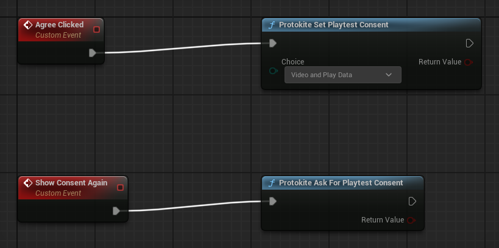
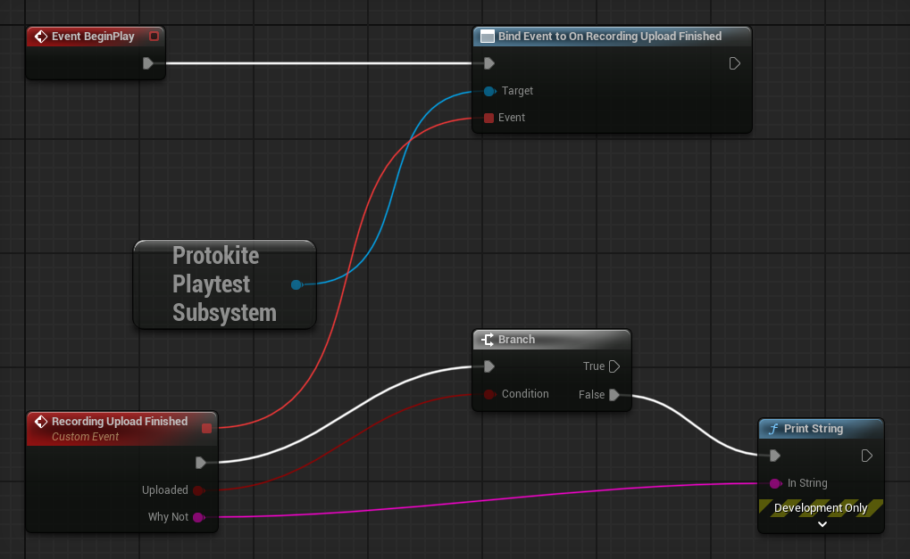
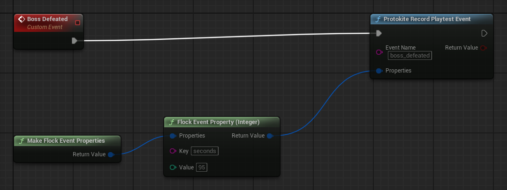
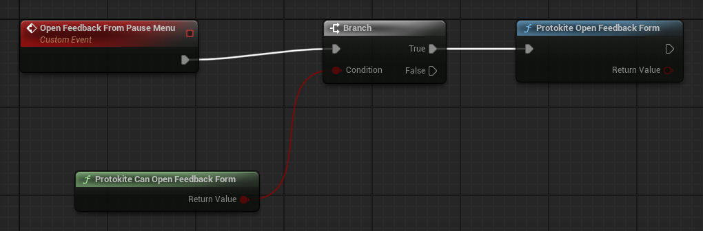

# Playtesting with Protokite

Protokite Playtest is an optional plugin that turns a Development build of your game into a playtest build for
Protokite. While a playtest runs, each launch of the game becomes one session on the playtest's
**Sessions** page, and the playtest decides what that session collects:

| Playtest feature | What the game sends | Where it shows |
|---|---|---|
| Always | One session per launch, named after the player's Steam id or this install's device id; when a player is signed in to Flock, their sign-in too, so the session can be linked to their Qwacks Community account | Protokite **Sessions** |
| `video_recording` | A recording of the game's screen, uploaded when it ends | The session's recording player |
| `heavy_analytics` | A performance window every ten seconds of play, each level load, and your own playtest events | Flock **Game Metrics**, under the `playtest` category |
| `exception_capturing` | Nothing extra: the Flock SDK already reports exceptions, and the playtest only asks for them | Flock **Diagnostics → Errors** |
| A published feedback form | The player's answers | The session card, and the playtest's **Feedback form** page |

Everything is switched on the playtest's page in Protokite, so changing what a playtest collects needs no new build.

## Before you start

- **The Flock SDK is set up and working** in the project: API URL, API Key, Game Name and Game Version, with the
  Flock panel showing nothing to fix. The playtest runs through the Flock SDK and sends its API key.
- **A playtest exists in Protokite.** Creating one makes a Flock game version for it, named `pt-` followed by the
  test's id.
- **Playtest builds are Development builds.** A Shipping build compiles logging out, so the Flock SDK cannot report
  error lines or failed ensures from it (see [Shipping builds](#shipping-builds)).
- **Video is recorded on 64-bit Windows only.** Other platforms run every other part of the playtest and log once that
  they record no video.

## 1. Install the plugin

Releases carry `ProtokitePlaytest-<version>.zip` beside the Flock SDK's zip, from the same tag and at the same version.

1. Extract it into your project's `Plugins/` folder, so `Plugins/ProtokitePlaytest/` sits beside
   `Plugins/FlockUnrealSdk/`.
2. Enable **Protokite Playtest** under **Edit → Plugins**, and restart the editor so it builds.

If you cloned the SDK repository, copy or link `Plugins/FlockUnrealSdk/OptionalPlugins/ProtokitePlaytest/` to
`Plugins/ProtokitePlaytest/`: Unreal does not load a plugin from where that folder sits. Leave the plugin out of projects
that are not running playtests.

## 2. Point the build at the playtest

Protokite finds the playtest from the Flock game version the build sends.

1. Open the test in Protokite. Its **SDK** block shows the playtest's Flock version **ID**.
2. In *Project Settings → Plugins → Flock SDK Settings*, set **Game Version** to that version's **name**: `pt-`
   followed by the test's id (for example `pt-01JABCDEFGHJKMNPQRSTVWXYZ0`). The Flock SDK resolves the name to the ID
   Protokite showed. Do not paste the ID into the settings file instead: the Flock SDK resolves Game Version again
   whenever Game Version, API URL or API Key changes, and replaces an ID written by hand.
3. In *Project Settings → Plugins → Protokite Playtest Settings*, turn on **Enable Playtesting**. **Protokite API URL**
   is already set to production, `https://api-protokite.qwacks.com`; change it only to point at a local Protokite such as
   `http://localhost:8020`. The URL must start with `http://` or `https://` and contain no spaces; one that does not is
   refused rather than tidied up.

Pressing **Play** now says in the Play message log whatever in these settings would stop the playtest or change it,
each with a link to the page that fixes it: an empty or unusable Protokite API URL, the Flock SDK's analytics turned off,
a Game Version that is not a playtest's, and the settings a playtest session waits on. Nothing is said while
**Enable Playtesting** is off.

## 3. Sign a player in

**A playtest never signs a player in.** The playtest session starts from the Flock session, and a Flock session starts
once your game signs a player in, with **Analytics Enabled** and **Analytics Auto Start Session** on (or a Start
Session call) and consent granted when **Analytics Require Explicit Consent** is on. A device sign-in is enough and
needs no account.

When a player is signed in to Flock, the session start also carries their sign-in, so Protokite can link the session to the
player's Qwacks Community account when they have one. Nothing else is needed from the game:

- **A sign-in with a minute or less left** is renewed first, once per sign-in. One that could not be renewed but has not
  run out yet is still sent.
- **With no one signed in**, or a sign-in that has run out and cannot be renewed, the session starts unlinked.
- **Only the sign-in the launch's first Flock session started under** is linked: if the player signs out, anyone signs in,
  or the Flock SDK shuts down before the session starts, it starts unlinked.
- **The sign-in goes with the session start alone** and is never logged.

A playtest build with no sign-in screen of its own can sign in from the console in Development builds:
`Flock.LoginWithDevice`.

## 4. What the player is asked

**A playtest build asks its player what it may collect, and collects nothing until they answer.** The question is drawn
over the game as soon as this build's playtest is loaded, and offers four answers:

| Answer | What the playtest then collects |
|---|---|
| Record my screen and collect play data | Everything the playtest turns on |
| Record my screen only | The recording; no performance windows, level loads, playtest events or exceptions |
| Collect play data only | Those; no recording |
| Collect nothing | Nothing at all: no recording, nothing sent, and no session for the launch -- exactly what this build does with **Enable Playtesting** off |

**It is the playtest's own question and its words say so.** The Flock SDK's **Analytics Require Explicit Consent** is a
different question, asked by your game in your game's words about your game's analytics; neither answer moves the other.
The playtest's answer is kept in `Saved/ProtokitePlaytest/playtest_consent.json` and used by every later launch of that
build. Nothing an earlier launch left waiting is sent while the question is still on screen, and nothing is sent at all
while the answer is *collect nothing* -- a player who changes their mind has it sent in the same launch. The feedback form is not covered by it either way: it is sent only when a player fills it in and presses Send.

What a playtest asks for and what the player allowed are both named in the log when playtesting becomes ready, and
`playtest_consent` and `playtest_consent_asked` ride along with every session start, so a session with no recording
reads as a player who asked for none rather than a build that went wrong.

### Asking in your own screens

Your game can take this question over. The answer is one of five values (`EProtokitePlaytestConsentChoice`):

| Answer | Means |
|---|---|
| Not Answered (`NotAnswered`) | No answer yet: nothing is collected. Recording it forgets the answer, so the question is put again |
| Video And Play Data (`VideoAndPlayData`) | Record my screen and collect play data |
| Video Only (`VideoOnly`) | Record my screen only |
| Play Data Only (`PlayDataOnly`) | Collect play data only |
| Nothing (`Nothing`) | Collect nothing |

| Node (C++ on `UProtokitePlaytestLibrary`) | Does |
|---|---|
| **Protokite Get Playtest Consent** (`GetPlaytestConsent`) | What the build collects under: the player's answer, everything in a build that does not ask, nothing while a build that asks waits for one |
| **Protokite Get Players Consent Answer** (`GetPlayersConsentAnswer`) | What the player answered; Not Answered when they have not |
| **Protokite Describe Playtest Consent** (`DescribePlaytestConsent`) | One sentence saying what an answer allows, in the words the player was shown |
| **Protokite Set Playtest Consent** (`SetPlaytestConsent`) | Records an answer from your own screen. It is kept on this machine, used by every later launch and takes effect at once: Nothing stops a recording that is running. Returns whether the answer was saved |
| **Protokite Ask For Playtest Consent** (`AskForPlaytestConsent`) | Puts the plugin's question again now: what a "change what this playtest collects" entry in your menu calls. False, changing nothing, when no playtest is loaded, the feedback form is open, or there is no viewport to draw in |
| **Protokite Is Consent Question Open** (`IsConsentQuestionOpen`) | True while the question is on screen |



The same in C++ (the module must be in your Build.cs: see [Calling the plugin from C++](#calling-the-plugin-from-c)).
`WorldContextObject` is any object in the game's world, such as the widget making the call (`this`):

```cpp
#include "ProtokitePlaytestLibrary.h"

// Your consent screen's "Record my screen and collect play data" button.
if (!UProtokitePlaytestLibrary::SetPlaytestConsent(WorldContextObject, EProtokitePlaytestConsentChoice::VideoAndPlayData))
{
    // Not saved: no playtest subsystem in this game, or the answer could not be written to disk.
}

// A "Change what this playtest collects" entry in your menu: the plugin's own question, again.
if (!UProtokitePlaytestLibrary::AskForPlaytestConsent(WorldContextObject))
{
    // No playtest loaded, the feedback form is open, or no viewport to draw the question in.
}

// What the player chose, in the words they were shown.
const EProtokitePlaytestConsentChoice Answer = UProtokitePlaytestLibrary::GetPlayersConsentAnswer(WorldContextObject);
UE_LOG(LogTemp, Display, TEXT("%s"), *UProtokitePlaytestLibrary::DescribePlaytestConsent(Answer));
```

A player who has answered is not asked again by later launches, so an answer your screen records before this build's playtest
loads means the plugin's own question never appears.

While the question is up the player's input goes to it and the game keeps running, so a game that asks during play
pauses first if being unable to act would cost the player something. The plugin never pauses for it: your game knows
when its player can be interrupted, and pausing does nothing in a multiplayer match.

Turn **Ask The Player For Playtest Consent** off in *Protokite Playtest Settings* only where your players have been asked
another way, for an internal test on your own machines, or for an automated run with nobody there to answer. The build
then collects what the playtest turns on, and each session says the player was never asked. **An answer a player has
already given is still honoured** in such a build: the setting decides whether the question is put, not whether an
answer counts.

## 5. Play

The log, under `LogProtokitePlaytest`, says what the playtest is doing:

1. *Playtesting is set up and waiting for the Flock SDK to initialize*, then *fetching this build's playtest from
   Protokite*.
2. *Playtesting is ready*, naming the playtest and the features it turns on.
3. *Protokite session … started for this launch*, once a player is signed in and the Flock session has reached the
   server.

The session appears on the playtest's **Sessions** page. It ends when the game shuts down, or earlier with
**Protokite End Playtest Session**. A later Flock session, a sign-out or the Flock SDK initializing again neither ends nor
restarts it: a launch is one session.

Each change of status is logged once. A setting or a refusal that stops the playtest is a warning naming the setting;
waiting, fetching and being ready are ordinary lines; **Turned Off** says nothing, since it is every build that is not a
playtest build. Every status (`EProtokitePlaytestStatus`):

| Status | Meaning | Fix |
|---|---|---|
| `TurnedOff` | **Enable Playtesting** is off, or the game has no playtest subsystem | Nothing, in a build that is not a playtest build. Otherwise turn **Enable Playtesting** on |
| `ProtokiteApiUrlMissing` | **Enable Playtesting** is on and the URL is empty | Set **Protokite API URL** (production is `https://api-protokite.qwacks.com`) |
| `ProtokiteApiUrlUnusable` | No `http://` or `https://`, no host, or a space or line break in it | Correct the URL; it is never trimmed for you |
| `WaitingForFlock` | The settings are complete and the Flock SDK is not initialized yet, or has shut down | Nothing, once Flock initializes. If it stays here, read why Flock did not initialize (its settings, its log) |
| `FetchingPlaytestConfig` | Flock is initialized and this build's playtest is being fetched from Protokite | Nothing: it moves on by itself |
| `PlaytestNotLinked` | Protokite has no playtest for this build's Game Version ID | Point **Game Version** at the playtest's `pt-` version |
| `ProtokiteRefusedApiKey` | Protokite turned down the Flock API key, or the request reached it without one | Check **API Key** in the Flock SDK's settings |
| `PlaytestConfigUnavailable` | Protokite or the network kept failing, or the answer could not be read | Nothing: it is fetched again when the next Flock session starts, or when Flock initializes again |
| `PlaytestConfigForAnotherVersion` | Protokite answered with the playtest of a different Game Version ID than the one this build sent | Check **Game Version** names the playtest's `pt-` version, letter for letter |
| `PlaytestNoLongerCollecting` | The playtest has closed and takes no more sessions; playtest work stays off until the game is launched again | Reopen it in Protokite, or point Game Version at a running one |
| `WaitingForPlayerConsent` | The playtest is loaded and the player has not said what it may collect | Nothing: it is asked over the game. A console can answer with `ProtokitePlaytest.AnswerConsent` |
| `PlayerRefusedPlaytest` | The player asked for nothing to be collected | Nothing: it is their answer. **Protokite Ask For Playtest Consent** puts the question again |
| `Ready` | Playtest work may run. It does not mean a player is signed in or the session has started | Nothing |
| `Stopped` | The playtest subsystem has shut down with its game instance | Nothing: nothing runs after this |

In Blueprint, **Protokite Get Playtest Status** answers the same question, and **Protokite Describe Playtest Status** turns it
into the sentence the log uses. In Blueprint the values read as words (`ProtokiteApiUrlMissing` is *Protokite Api Url
Missing*).

## Video recording

When the playtest turns `video_recording` on, the game's screen is recorded from the moment the playtest loads, one
recording per launch, to a WebM file a browser plays. Background time is not recorded. The **Video Recording**
settings in *Protokite Playtest Settings* set the size, frame rate and bitrate (1280×720, 30 frames a second and
2000 kbps by default), and two limits, whichever comes first: **Recording Length Limit** (60 minutes) and
**Recording Size Limit** (1536 MB).

A recording is uploaded to its session:

- when a length or size limit ends it;
- when the game asks, with **Protokite Stop And Upload Playtest Recording** (C++:
  `UProtokitePlaytestLibrary::StopAndUploadPlaytestRecording`, or the subsystem's `StopVideoRecordingAndUploadIt`) or the
  feedback form's **Upload your recording** button;
- when the game stops it for good, with **Protokite Stop Video Recording**;
- and at the start of a later launch, for anything an earlier launch could not send: a failed upload, a quit, a crash.

Quitting does not upload: a whole recording cannot be sent inside a shutdown, so it is kept and the next launch sends
it. A recording is deleted once uploaded. Recordings wait under `Saved/ProtokitePlaytest/Recordings/`, inside
**Recordings Disk Budget** (4096 MB), and when room is short the oldest test videos go first and recordings waiting to be
uploaded go last. A recording no playtest session started for can never be uploaded, so the next launch deletes it.

Offer a player a way to send their recording only while **Protokite Can Send Playtest Recording** is true. It is false
when no session has started for the recording, and pressing a button then would stop the recording and send nothing.

### Hearing how the upload went

To tell the player how it went, bind the playtest subsystem's **On Recording Upload Finished** event. It is raised once
when the launch's recording finishes, with two parameters:

| Parameter | Holds |
|---|---|
| `bUploaded` (*Uploaded*) | True when the recording reached its session |
| `WhyNot` (*Why Not*) | When it was not uploaded, why: including when the upload could not begin at all (no Protokite session to send it to, the Flock SDK not running). Empty when it was uploaded |

A recording that was not uploaded stays on disk for a later launch, unless no session started for it. The event is not
raised while the game is closing, for a recording an earlier launch left, or for a test video.

In Blueprint, reach the subsystem by searching the node menu for **Get ProtokitePlaytestSubsystem** (under *GameInstance
Subsystems*); in the graph the node is titled **Protokite Playtest Subsystem**. Drag off it and bind the event once, such as on
Event BeginPlay:



In C++ the handler is a `UFUNCTION` of your game instance (or any `UObject` that outlives the recording), bound with
`AddDynamic`. The module must be in your Build.cs: see [Calling the plugin from C++](#calling-the-plugin-from-c).

```cpp
// MyGameInstance.h
UFUNCTION()
void HandleRecordingUploadFinished(bool bUploaded, const FString& WhyNot);

// MyGameInstance.cpp
#include "ProtokitePlaytestSubsystem.h"

void UMyGameInstance::Init()
{
    Super::Init();
    if (UProtokitePlaytestSubsystem* Playtest = GetSubsystem<UProtokitePlaytestSubsystem>())
    {
        Playtest->OnRecordingUploadFinished.AddDynamic(this, &UMyGameInstance::HandleRecordingUploadFinished);
    }
}

void UMyGameInstance::HandleRecordingUploadFinished(bool bUploaded, const FString& WhyNot)
{
    if (bUploaded)
    {
        UE_LOG(LogTemp, Display, TEXT("Your recording reached the studio. Thank you."));
        return;
    }
    UE_LOG(LogTemp, Warning, TEXT("Your recording was not sent: %s"), *WhyNot);
}
```

From an actor or a widget, the subsystem is `GetGameInstance()->GetSubsystem<UProtokitePlaytestSubsystem>()`.

## Heavy analytics

When the playtest turns `heavy_analytics` on, the plugin sends through the Flock SDK's analytics, under the `playtest`
category:

- `performance_window` for every ten seconds of play: median, 95th and 99th percentile frame time, hitches, and memory
  used and at its peak;
- `level_loaded` for every level this game instance loads, with the level before it and, for a blocking load, how long
  it took;
- your own events, with **Protokite Record Playtest Event** (below).

Nothing is sent while the Flock SDK's **Analytics Enabled** is off; the log says so once.

### Recording your own playtest events

**Protokite Record Playtest Event** takes the event's name and its properties. Build the properties the way you build an
analytics event's:

1. Start with **Make Flock Event Properties** (under *Flock | Analytics*): empty properties, with nothing to wire in.
2. Add one field per node: **Flock Event Property (Integer)**, **(String)**, **(Float)**, **(Boolean)** or **(String Array)**.
   Each returns the properties with one more field, so chain them.
3. Feed the last one into the node's **Properties**. Leave **Properties** unwired to send none.



In C++ (the module must be in your Build.cs: see [Calling the plugin from C++](#calling-the-plugin-from-c)):

```cpp
#include "ProtokitePlaytestLibrary.h"

FFlockCommandData Properties;
Properties.Set(TEXT("seconds"), 95);
if (!UProtokitePlaytestLibrary::RecordPlaytestEvent(WorldContextObject, TEXT("boss_defeated"), Properties))
{
    // Not recorded. That is normal outside a playtest build, so a game calls this freely.
}
```

It returns false, and records nothing, when:

- playtesting is not **Ready**, or the playtest does not turn `heavy_analytics` on, or the player did not allow play data;
- the name is one the plugin sends itself (`performance_window`, `level_loaded`);
- the Flock SDK refuses the event: its analytics off (**Analytics Enabled**), consent withheld, an empty name,
  `session_started`, or a name over 200 characters.

It never waits on the network.

## Exceptions

Exceptions stay the Flock SDK's: it captures error lines, failed ensures, Blueprint script errors such as Accessed
None, and crashes, with its own settings under **Analytics | Exceptions**, and reports them on **Diagnostics → Errors**
(see [Diagnostics](diagnostics.md)). A playtest's `exception_capturing` switch never turns that on or off. When a
playtest asks for exceptions and **Analytics Capture Exceptions** is off, the log warns once as the session starts.

To check exceptions reach the dashboard, type `Flock.RaiseTestException error` or
`Flock.RaiseTestException blueprint 100` in the console of a Development build. A hundred of the same fault arrive as
one report, then one repeat report counting the other ninety-nine once the repeat window closes.

## The feedback form

When the playtest publishes a feedback form, the plugin draws it over the game:

- **Players open it** with **Feedback Form Key** (F9 by default; set it to none to turn the key off), or **your game opens
  it**, from a pause menu for example (below).
- **While it is open** the mouse shows and typing goes to it; closing or sending it puts both back as they were.
- **Pause The Game While The Form Is Open** is off by default, because pausing does nothing in a multiplayer game and loses
  what a single player was about to describe.
- **Every question comes from the playtest**, so editing the form in Protokite changes what players see with no new build.
- **Answers are checked before sending**, with every problem shown against its question. A form that cannot be sent is kept
  and sent by a later launch, and sending again in the same session replaces the earlier answers.

### Opening it from your own menu

1. Ask **Protokite Can Open Feedback Form**. It is false when there is no form to show (playtesting is not ready, or the
   playtest published none): leave your "Give feedback" entry out rather than offering one that does nothing.
2. Call **Protokite Open Feedback Form**. It returns false, and changes nothing, when there is no form to show or it is
   already open. **Protokite Close Feedback Form** closes it without sending; **Protokite Is Feedback Form Open** says whether
   it is up.



The same in C++ (the module must be in your Build.cs: see [Calling the plugin from C++](#calling-the-plugin-from-c)).
`WorldContextObject` is any object in the game's world, such as the pause menu widget (`this`):

```cpp
#include "ProtokitePlaytestLibrary.h"

// Show the pause menu's "Give feedback" button only when there is a form to open.
const bool bOfferFeedback = UProtokitePlaytestLibrary::CanOpenFeedbackForm(WorldContextObject);

// When the player presses it:
if (bOfferFeedback && !UProtokitePlaytestLibrary::OpenFeedbackForm(WorldContextObject))
{
    // Already open, or the form went away since the menu was drawn.
}
```

### Your own logos on the form

Set them under **Feedback Form** in *Project Settings → Plugins → Protokite Playtest Settings*, or from a Blueprint with
**Protokite Get Playtest Settings**; every one is read each time the form opens.

| Setting | Default | What it does |
| --- | --- | --- |
| Feedback Form Logos | empty | Your own images, such as your studio's or an event's sponsors', drawn left to right in one row above the form's title, with a thin line under them. Import them as below |
| Feedback Form Logo Height | 40 | How tall each logo is drawn, from 16 to 96, at the same scale as the rest of the form |
| Feedback Form Footer Logo | empty | Empty, the form shows Powered by Qwacks at its bottom left, on the row of Close and Send. Set, one small image of your own is drawn there instead. There is no setting to hide the mark; your own image replaces it |
| Feedback Form Footer Logo Height | 22 | How tall the footer logo is drawn, from 12 to 48, at the same scale as the rest of the form |

How they are drawn:

- Each logo keeps its own shape. When the row does not fit, all of them are drawn smaller together; a logo wider than the
  form is drawn smaller too. An empty slot is left out.
- On a narrow form the footer logo is drawn smaller, never the buttons.
- Images with transparent backgrounds suit the form's dark panel.
- The images listed here are packaged with your game.

How to import each image, the footer logo included:

- **Padding and Resizing** set to **None**. Otherwise it is stretched to a power of two and drawn soft, or padded and drawn
  squeezed above a band of padding.
- **With mipmaps**, so it stays smooth drawn smaller: **Mip Gen Settings** anything but **NoMipmaps**, and not
  **FromTextureGroup** when the Texture Group is **UI**.

### A form of your own

A game can draw the questions in its own UI and still have the plugin check, keep and send the answers.

1. **Read the form** with **Protokite Get Feedback Form**. It returns false, with an empty form, when there is none: the
   same test as Can Open Feedback Form. The form's `Fields` are the questions, in the order the studio arranged them.
2. **Draw each question by its kind.** Each one has:

   | Member | Holds |
   |---|---|
   | `Id` | Where its answer goes: give it to the Set nodes |
   | `Type` | Its kind. Compare it with the **Protokite Feedback Question Kind Text / Text Area / Rating / Select / Checkbox** nodes (C++: `IsOfKind` with `ProtokitePlaytestFormFieldTypes`), never a typed name. Treat a kind you do not know as text, which is how the server reads it |
   | `Label`, `HelpText` | What to show; `HelpText` is empty when there is none |
   | `Options` | A select question's choices; empty for other kinds |
   | `Required` | Whether it needs an answer |

3. **Record each answer** with the node for its kind:

   | Kind | Node (C++ on `FProtokitePlaytestFormAnswers`) | Answer |
   |---|---|---|
   | Text, Text Area, and any kind you do not know | **Set Feedback Text Answer** (`SetText`) | the text |
   | Rating | **Set Feedback Rating Answer** (`SetRating`) | 1 to 5; 0 clears it, which reads as unanswered |
   | Checkbox | **Set Feedback Checkbox Answer** (`SetChecked`) | ticked or not |
   | Select | **Set Feedback Chosen Option** (`SetChosenOption`) | one of the question's `Options`, letter for letter |

4. **Find the problems** with **Find Feedback Form Problems** (Answers, Form): every question the server would turn the
   answers away over, in the form's order, each with its `FieldId` and a `Message` to show the player. Empty means they
   would be taken.
5. **Send** with **Protokite Send Feedback Form Answers**. It returns:
   - **true** when the answers were sent, or kept on disk to be sent by a later launch: the player is never made to wait;
   - **false**, with a warning in the log saying why, when there is no playtest or no published form, nobody to attribute
     the answers to, or they could be neither kept nor sent.

   It sends what it is given: answers with problems are sent and refused, so find the problems first.

Two rules that are easy to miss:

- **Set every checkbox**, ticked or not. The server counts an unticked box as an answer, and a needed checkbox that
  was never set is missing.
- **A chosen option must match letter for letter.** The server compares options exactly, so `crash` is not `Crash`.

**In Blueprint the Set nodes have no execution pins and change nothing in place.** Each takes an Answers value and returns a new one with
that answer added: wire its return into the next Set node's **Answers**. Feed the first one an **Answers** variable of type
*Protokite Playtest Form Answers* (a new one is empty), set the variable to the last one's return, and give that variable to
Find Feedback Form Problems and Send.


In C++ the answers are one `FProtokitePlaytestFormAnswers` that the setters change in place. The module must be in your
Build.cs: see [Calling the plugin from C++](#calling-the-plugin-from-c). The ids below belong to an example form; yours come
from `Form.Fields`.

```cpp
#include "ProtokitePlaytestLibrary.h"

// 1. Read the form. False when the playtest published none: leave your feedback screen out.
FProtokitePlaytestForm Form;
if (!UProtokitePlaytestLibrary::GetFeedbackForm(WorldContextObject, Form))
{
    return;
}

// 2. Draw each question by its kind.
for (const FProtokitePlaytestFormField& Question : Form.Fields)
{
    // Question.Label and Question.HelpText to show; Question.Required when it needs an answer.
    if (Question.IsOfKind(ProtokitePlaytestFormFieldTypes::Rating))
    {
        // Five stars.
    }
    else if (Question.IsOfKind(ProtokitePlaytestFormFieldTypes::Checkbox))
    {
        // A tickbox.
    }
    else if (Question.IsOfKind(ProtokitePlaytestFormFieldTypes::Select))
    {
        // One button for each of Question.Options.
    }
    else if (Question.IsOfKind(ProtokitePlaytestFormFieldTypes::TextArea))
    {
        // A box of several lines.
    }
    else
    {
        // Text, and any kind this plugin does not know: a one-line text box.
    }
}

// 3. Record what the player entered, each with the setter for its question's kind.
FProtokitePlaytestFormAnswers Answers;
Answers.SetRating(TEXT("fun"), 4);
Answers.SetText(TEXT("comments"), TEXT("The second level was too long"));
Answers.SetChecked(TEXT("would_play_again"), false);           // every checkbox, ticked or not
Answers.SetChosenOption(TEXT("controller"), TEXT("Keyboard"));  // one of the question's Options, letter for letter

// 4. Show each problem against its question, and send nothing while there are any.
const TArray<FProtokitePlaytestFormProblem> Problems = Answers.FindProblems(Form);
for (const FProtokitePlaytestFormProblem& Problem : Problems)
{
    UE_LOG(LogTemp, Display, TEXT("%s: %s"), *Problem.FieldId, *Problem.Message);
}
if (Problems.Num() > 0)
{
    return;
}

// 5. Send: true when sent or kept for a later launch; false, with the log saying why, when it cannot go at all.
if (!UProtokitePlaytestLibrary::SendFeedbackFormAnswers(WorldContextObject, Answers))
{
    UE_LOG(LogTemp, Warning, TEXT("The feedback could not be sent or kept."));
}
```

## Blueprint nodes

All under *Protokite | Playtest*. Each finds the playtest from the calling graph and is safe in every build: with no
playtest running it answers false, empty or Turned Off and changes nothing. The exception is **Protokite Get Playtest
Settings**, which needs no playtest and hands back the project's settings.

| Node | Answers or does |
|---|---|
| Protokite Get Playtest Status, Protokite Is Playtest Ready, Protokite Describe Playtest Status | Whether playtest work may run, and why not |
| Protokite Is Playtest Feature Enabled, with Protokite Playtest Feature Video Recording / Exception Capturing / Heavy Analytics | Whether the playtest turns a feature on |
| Protokite Get Playtest Consent, Protokite Get Players Consent Answer, Protokite Describe Playtest Consent | What the player let the playtest collect |
| Protokite Set Playtest Consent, Protokite Ask For Playtest Consent, Protokite Is Consent Question Open | Answering it from your own screens, and asking it again |
| Protokite Get Playtest Session Id, Protokite End Playtest Session | The launch's Protokite session |
| Protokite Record Playtest Event | Records one of your own playtest events |
| Protokite Is Recording Video, Protokite Stop Video Recording | The launch's recording |
| Protokite Can Send Playtest Recording, Protokite Stop And Upload Playtest Recording | Sending the recording now |
| Protokite Can Open Feedback Form, Protokite Open / Close Feedback Form, Protokite Is Feedback Form Open | The built-in form |
| Protokite Get Playtest Settings | The project's playtest settings, to change the form's logos while the game runs. It needs no playtest. A change is not saved and lasts until the game quits; in Play In Editor it lasts until the editor closes, and saving Project Settings meanwhile keeps it |
| Protokite Get Feedback Form, Set Feedback Text Answer, Set Feedback Rating Answer, Set Feedback Checkbox Answer, Set Feedback Chosen Option, Find Feedback Form Problems, Protokite Send Feedback Form Answers | A form of your own |
| Protokite Feedback Question Kind Text / Text Area / Rating / Select / Checkbox | A question's kind, to compare with its Type |

The playtest subsystem's own **On Recording Upload Finished** event is reached through the node **Get
ProtokitePlaytestSubsystem** in the node menu, titled **Protokite Playtest Subsystem** in the graph (see
[Hearing how the upload went](#hearing-how-the-upload-went)).

## Calling the plugin from C++

Every node above is a static function of `UProtokitePlaytestLibrary` (`ProtokitePlaytestLibrary.h`), named as the node is
without "Protokite" (**Protokite Open Feedback Form** is `OpenFeedbackForm`), and the subsystem is
`UProtokitePlaytestSubsystem` (`ProtokitePlaytestSubsystem.h`). To include them, add the module to your game module's
`Build.cs`:

```csharp
PrivateDependencyModuleNames.Add("ProtokitePlaytest");
```

**That makes the optional plugin required by your module**: the game no longer builds without Protokite Playtest installed
and enabled. A game that keeps the plugin optional, so it can leave it out of builds that are not playtests, calls the
Blueprint nodes instead, which need no Build.cs line.

## Trying it in the editor

- **Before any playtest exists**, tick **Record Video In Play In Editor** in *Project Settings → Plugins → Protokite
  Playtest Local Settings* and press Play, or type `ProtokitePlaytest.RecordTestVideo 30` in a Development build's console.
  Test videos are saved under `Saved/ProtokitePlaytest/Recordings/TestVideos/` and never uploaded.
- **Against a real playtest**, press Play with the settings above and sign in with `Flock.LoginWithDevice`. Then:

| Console command (Development builds) | Does |
|---|---|
| `ProtokitePlaytest.AnswerConsent <answer>` | Answers what the playtest may collect: `video_and_play_data`, `video_only`, `play_data_only`, `nothing`, or `not_answered` to be asked again |
| `ProtokitePlaytest.OpenFeedbackForm [seconds]` | Opens the form, after a wait if given |
| `ProtokitePlaytest.SendTestFeedback [seconds]` | Fills in the published form and sends it, to check answers reach Protokite |
| `ProtokitePlaytest.StopVideoRecordingAndUploadIt [seconds]` | Stops the recording and uploads it |
| `ProtokitePlaytest.StopVideoRecording` | Stops the recording; like any finished one, it is uploaded when it has a session |
| `Flock.RaiseTestException [error\|blueprint] [times]` | Raises a fault the Flock SDK reports |
| `ProtokitePlaytest.SelfTest [closed playtest's Game Version ID]` | Checks the whole playtest against Protokite; see below |

The waits exist because every `-ExecCmds` command runs on the first frame, before anything has been recorded or a
session has started.

## Checking a playtest build

`ProtokitePlaytest.SelfTest` checks everything a playtest build does against your real Protokite in one go, and logs a
line per step and a count at the end: `Playtest self-test finished: 16 passed, 0 failed, 1 skipped.` Development builds
only.

Each check sits beside a request Protokite must refuse: a wrong API key, a missing one, a version no playtest is linked
to, a session start that names no player, a form missing a needed answer or choosing an option that is not on the list,
and a form, upload link and end for a session that does not exist. A check that only ever succeeds cannot tell a working
build from a broken one. A refusal passes only with its own HTTP status and, for a form, the question it names.

It signs nobody in, so sign in first. From a script:

```
UnrealEditor-Cmd.exe MyGame.uproject -game -windowed -ExecCmds="Flock.LoginWithDevice, ProtokitePlaytest.SelfTest, Flock.QuitAfterSeconds 90" -log
```

- **It ends the launch's session as its last step**, so run it in a launch of its own. A session a refusal should have
  prevented is ended at once, so a run leaves nothing open.
- **It leaves a trace on your dashboards:** one filled-in form on its session, one `playtest_self_test` event, one
  Blueprint fault naming `ProtokitePlaytestSelfTestTarget` (raised twice, so its repeat is counted) and the launch's
  recording.
- **A step is skipped, saying why,** when the playtest does not turn its feature on; when the build has no video
  encoder, which is every platform but 64-bit Windows; when the launch cannot draw (`-nullrhi`), since nothing is
  recorded; when **Analytics Cache Failed Events** is off, since a report sent the moment
  it is made cannot be watched; and for a closed playtest unless you name one:
  `ProtokitePlaytest.SelfTest <Game Version ID of a closed playtest>`.

## Shipping builds

A Shipping build that has **Enable Playtesting** on, or that carries a playtest's `pt-` Game Version, gets a warning
while it builds, and the build still succeeds. The warning comes from the plugin's build rules, which a clean build
reads but an unchanged rebuild skips, so package a release from a clean build. A Shipping build also sends the Flock SDK's `exception_capture_limited`
entry, once per build, naming what it cannot capture there. Build playtests as Development, and point Game Version back
at a release version before shipping.

## Telling your players

A playtest build records the player's screen when the playtest turns video on, and sends what they type into the
feedback form. Tell your testers before they play: what is recorded, that it goes to your studio's Protokite
playtest, and how to reach you to have it removed. Nothing is collected unless **Enable Playtesting** is on in the build
and the playtest in Protokite turns the feature on, and a build without the plugin collects none of it.

The build asks them too, before collecting anything, and does what they answer -- see [What the player is
asked](#4-what-the-player-is-asked). That question is about this playtest alone; anything your game collects of its own
is still yours to ask about.

## What stays on the player's machine

| Folder under `Saved/ProtokitePlaytest/` | Holds | Until |
|---|---|---|
| `Recordings/Playtest/` | Playtest recordings, each with the session it belongs to | Uploaded, or deleted for disk room, oldest last |
| `Recordings/TestVideos/` | Test videos | Deleted for disk room, oldest first |
| `FeedbackForms/` | Answers that could not be sent | Sent, or refused by the server |
| `device_id.txt` | This install's device id, when no Steam id is available | Kept, so one install stays one player |
| `playtest_consent.json` | What the player let this playtest collect | Kept, so they are asked once rather than every launch |
