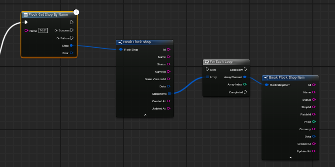
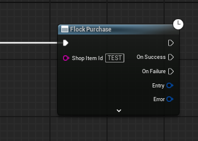

# Shop

A **shop** is a named collection of **shop items**. An item has a price, a currency, and free-form
`data` / `stats` the game reads however it likes. Buying one credits it to a player's **inventory**.

Catalog reads are cached and served from the offline snapshot; purchases and inventory never are — see
[Caching and money-safety](#caching-and-money-safety), which is the part of this guide worth reading even
if you skip the rest.

## Blueprint

The nodes live under *Flock | Shop*:

| Node | Returns |
|---|---|
| `Flock Get All Shops` | a page of shops (`Page`, `Limit`) |
| `Flock Get Shop By Id` | one shop |
| `Flock Get Shop By Name` | one shop, found by its dashboard name |
| `Flock Get Shop Item` | one item by its id |
| `Flock Get Shop Items` | every item in a shop (optional `Patch Id`) |
| `Flock Purchase` | the purchase result: what was bought, what it granted, and the wallet after |
| `Flock Consume Inventory Item` | the consumed entry, what it granted, and the wallet after |
| `Flock Get Player Inventory` | a page of what a player owns |



**You do not pass a player.** These act for the signed-in player, and the `Player Id` pin is tucked into
each node's advanced section (the little arrow) for the rarer case of reading someone else's inventory.

An item's free-form **Data** and **Stats** pins are `FFlockJsonData` handles, not strings. Read them with
the *Get Json Int / Float / String / Bool / String Array* nodes, which take a dotted path and a fallback —
no JSON parsing node needed.



**Break the Purchase Result to see what actually happened.** It carries `Inventory` (the row the player
now owns), `Granted` (what the purchase handed over immediately), `Wallet` (the balances afterwards) and
`Status`. Purchase spends only game currencies from the player's wallet, so a purchase it makes is paid at
once and *Is Purchase Paid* is true. An item priced in a currency the game's currency config lists as real money
is refused with `ShopRealCurrencyNeedsCheckout` (the server reads that list for the Game Version the game sends):
price it in a game currency, or sell it through the App Store or Google Play and redeem the store's purchase with
`RedeemStoreReceipt` (see [Redeeming a store purchase](#redeeming-a-store-purchase)). An item switched off (Inactive) in the
dashboard, or one in a switched-off shop, is refused with `ShopItemNotForSale` and nothing is bought; the shop provider
then clears the shops it kept, so reading the shop again shows the item gone from its items (*Flock Get Shop Item*,
which reads one item by its id, still returns it, its `Status` inactive). A purchase refused with
`ShopInsufficientFunds` or `ShopCurrencyNotHeld` drops the cached player data, so the next wallet read asks the server.
While a player is signed in, a
`Player Id` naming anyone else is refused with `ShopPlayerMismatch` (the server buys only for the player signed in): leave it empty.
`Status` is still one of the
server's purchase statuses (`FlockPurchaseStatuses`): compare it against the *Flock Purchase Status* nodes, never a
typed-out string. A purchase or consume that reports a wallet also writes it into the cached
player data, so the next read of that template shows the new balance.

`Inventory` can be **empty**, and that is not an error: an item that grants its contents outright — a
currency pack — creates nothing to own and reports the grant instead. Use *Has Inventory Row* before
reading it rather than checking the Id yourself.

For rewards, branch with *Is Currency Reward* rather than comparing `Type` to a typed-out `"currency"`.
The server owns that set and can add kinds; a literal that does not match reads as "not a currency
reward" and silently skips the grant.

After a schema sync you can replace the id wiring entirely: the generated `Purchase` macro takes a typed
`FlockShopItemId` dropdown instead. See [Code generation](codegen.md).

## C++

Everything lives on the shop provider:

```cpp
UFlockSubsystem* Sdk = UFlockSubsystem::Get(this);

// Browse.
Sdk->GetShopProvider()->GetByName(TEXT("Starter"),
    [Sdk](TFlockResult<FFlockShop> Shop)
    {
        if (!Shop.bSuccess) { return; }

        for (const FFlockShopItem& Item : Shop.Value.ShopItems)
        {
            int32 Damage = 0;
            Item.Stats.TryGetInt(TEXT("damage"), Damage);   // free-form, read by dotted path
        }
    });

// Buy. ItemId is the shop item's Id from its shop (Item.Id above): not the item's name, and not the
// shop's id. An empty player id resolves the signed-in player.
Sdk->GetShopProvider()->Purchase(ItemId, FString(),
    [](TFlockResult<FFlockPurchaseResult> Bought)
    {
        if (!Bought.bSuccess)
        {
            if (Bought.Error.ErrorCode == EFlockErrorCode::ShopInsufficientFunds)
            {
                // The server declined — show the player, don't retry.
            }
            // What went wrong, then a "Fix:" line saying how to fix it.
            UE_LOG(LogTemp, Warning, TEXT("%s"), *Bought.Error.ToDisplayText());
            return;
        }

        // The row can be absent: a currency pack grants its contents and creates nothing to own.
        if (Bought.Value.HasInventoryRow()) { /* the player now owns this */ }

        for (const FFlockShopItemReward& Reward : Bought.Value.Granted)
        {
            // Compare against the constant, never a literal — the server can add kinds.
            if (Reward.Type == FlockShopItemRewardTypes::Currency) { /* Reward.Code, Reward.Amount */ }
        }
    });

// Use something up. Grants whatever the entry carries.
Sdk->GetShopProvider()->Consume(InventoryId,
    [](TFlockResult<FFlockConsumeResult> Consumed) { /* Consumed.Value.Granted, .Wallet */ });

// What they own.
Sdk->GetShopProvider()->GetPlayerInventory(FString(), /*Page*/ 1, /*Limit*/ 100, OnInventory);
```

## Real-money items

Each item says whether it costs real money and what it is called in each store. The server sends both with the catalog,
from the game's currency config and the product ids set in the Flock dashboard. Like the rest of the catalog, they are
kept for the session, and in the offline snapshot when **Enable Offline Cache** is on, so a change made in the dashboard
shows after the shop provider's `ClearCache()` (C++ only) or on the next launch with a connection. A snapshot written by
an SDK older than 1.42.0 holds neither: read offline, its items say `IsRealMoney` false and have no product ids until one
read reaches the server.

```cpp
Sdk->GetShopProvider()->GetItem(ShopItemId,
    [](TFlockResult<FFlockShopItem> Read)
    {
        if (!Read.bSuccess || !Read.Value.IsRealMoney) { return; }

        // Paid through a store or a web checkout, never from the wallet: Purchase refuses it, and a store's
        // purchase of it is redeemed with RedeemStoreReceipt.
        FString ProductId;
        if (Read.Value.FindStoreProductId(FlockPaymentProviders::GooglePlay, ProductId))
        {
            UE_LOG(LogTemp, Display, TEXT("Sold on Google Play as %s"), *ProductId);
        }
    });
```

In Blueprint, break the item for *Is Real Money* and *Store Product Ids*, and look an id up with *Find Store Product Id*,
giving it the *Flock Payment Provider Apple App Store* or *Flock Payment Provider Google Play* node as the store.

`IsRealMoney` is true when the item's currency is one the currency config lists as real money; a server that does not
send it reads false. For such an item `Price` is in the currency's smallest unit (199 is USD 1.99), but a phone shows the
player the store's own price for the product, in their currency and with their taxes, so show that one there.
`StoreProductIds` is keyed by store name (`FlockPaymentProviders::AppleAppStore`, `FlockPaymentProviders::GooglePlay`),
holds each id exactly as set in the dashboard, and is empty for an item with no product id. Use `FindStoreProductId`
rather than the map's own `Find`: a map of strings ignores letter case, and a store does not. `Type` is one of
`FlockShopItemTypes` (the *Flock Shop Item Type* nodes): in a store, set up a `FlockShopItemTypes::CurrencyPack` or
`FlockShopItemTypes::Consumable` item as a consumable product and a `FlockShopItemTypes::Standard` item as a one-time product. Store names and item kinds are strings rather than enums, for the same
reason as a reward's `Type`.

### Redeeming a store purchase

When the player has paid the App Store or Google Play for an item, hand the store's purchase to `RedeemStoreReceipt`
(C++). Flock asks the store about it and hands the item over, completing with the purchase as `Purchase` does, and the
wallet it reports goes into the cached player data. Make the receipt with `FFlockStoreReceipt::FromAppleAppStore` (the
App Store's transaction id) or `FFlockStoreReceipt::FromGooglePlay` (Google Play's product id and purchase token), each id
exactly as the store gave it.

```cpp
// The store's purchase is left unfinished until Flock has handed the item over.
Sdk->GetShopProvider()->RedeemStoreReceipt(ShopItemId,
    FFlockStoreReceipt::FromGooglePlay(ProductId, PurchaseToken),
    [](TFlockResult<FFlockPurchaseResult> Redeemed)
    {
        if (Redeemed.bSuccess)
        {
            // Finish the purchase in the store now. Redeemed.Value.Granted, .Inventory and .Wallet say what it handed over.
            return;
        }
        // Leave the store's purchase unfinished, and send the same receipt again later.
        UE_LOG(LogTemp, Warning, TEXT("%s"), *Redeemed.Error.ToDisplayText());
    });
```

- **It needs a signed-in player.** The server redeems for the player the sign-in names, so with nobody signed in the call
  fails with an `Auth` error before anything is sent, and a retry is never sent once that player signs out or another
  signs in.
- **It is safe to send again.** One store purchase makes one Flock purchase, and a repeat answers with what the first
  delivered, so the call itself re-sends after a timeout, a dropped connection or a 5xx, the store being unavailable
  (`PaymentProviderStoreUnavailable`) included, under the retry policy. A 5xx naming a setting someone has to fix
  (`PaymentProviderCredentialsUnreadable`) is not re-sent: it stays the same until the setting is fixed. An expired
  token is renewed once and the redemption sent again. Every refusal
  says why in its own code and fix: `PaymentProviderReceiptProductMismatch` (the receipt is for another product, or the
  item has no product id in that store), `PaymentProviderReceiptPending` (Google is still waiting for the payment),
  `PaymentProviderReceiptBelongsToAnotherPlayer`, `PaymentProviderProviderNotFound` (the store is not connected under
  Monetization > Payments in the Flock dashboard), `PaymentProviderStoreCredentialsRejected` (the store refused the
  game's own keys), and the rest in [Errors](errors.md).
- **Keep the store's purchase until it succeeds.** A failure, a setup fault in the dashboard included, keeps nothing on the
  server, so the same receipt redeems once the cause is fixed. A 2xx that names no purchase, or whose body cannot be
  read, is a failure too, and drops the cached player data.
- **Ids are sent exactly as given.** An empty id, or one with spaces around it, is refused (`Validation`) rather than
  trimmed: the spaces came from wherever it was copied. The SDK does not compare the receipt's product with the item's
  `StoreProductIds`; the server does.
- **No analytics transaction is recorded**: the server records the revenue of each store purchase it confirms.

## Caching and money-safety

- **A purchase is never retried.** It posts non-idempotently, so an ambiguous failure — a timeout, a
  dropped connection — is reported rather than re-sent. A timeout may mean the charge already landed, and
  the SDK will not risk charging twice. Show the failure and let the player decide. A success that names no
  purchase fails too: read the inventory and wallet (the cached player data is dropped, so that read asks the server)
  before offering the item again. Redeeming a store purchase is the exception: the store already took the money,
  and the server makes one purchase per store transaction, so it is re-sent.
- **Consuming follows the same rule, in the other direction.** It credits currency, so a re-send after an
  ambiguous failure would grant twice. Only a failure that proves the server never processed the request
  is retried; everything else is reported.
- **A purchase is never queued offline**, and neither is a consume. Unlike a player-data write, each is sent at
  most once with the server unreachable (a purchase of an item not read yet first reads it, and fails there),
  fails with a `Connection` error, and is not sent again when the network comes back. There is no offline shopping.
- **Rewards are advertised before they are bought.** An item's `Rewards` says what buying it will grant,
  so a shop tile can show "500 gold" without a transaction. It is empty for a plain item.
- **Inventory is always fetched fresh.** It is never cached and never snapshotted, because it is what a
  player owns — stale here is worse than a round trip.
- **Catalog reads are cached and snapshot-backed.** Shops and items are memoized in-process and written to
  the offline snapshot, so a returning player with no connection still sees the store. Prices come from
  that snapshot too, so treat a displayed price as advisory until the purchase succeeds — the server is
  the authority.
- **Purchases report themselves to analytics.** Started / Purchased / Failed transactions are dispatched
  alongside the call for revenue metrics. They are fire-and-forget: a failed analytics call never fails a
  purchase, and analytics being disabled simply skips them.
- **`ClearCache()`** drops the in-process caches and the shop snapshot category, so the next read hits the
  backend. C++ only.

## Things worth knowing

- **`Get Shop Items` takes an optional patch id.** Leaving it empty reads the current items; supplying one
  reads the catalog as of that patch, which is how a limited-time or A/B store front is served.
- **Paged reads return a page struct**, not a bare array — `Items`, `Total`, `Page`, `Limit`. Ask for the
  next page by incrementing `Page`; there is no cursor to carry.
- **`data` and `stats` are author data.** The SDK never transforms their keys, so they read back exactly
  as the dashboard declares them.

---

[← Back to the README](../README.md)
